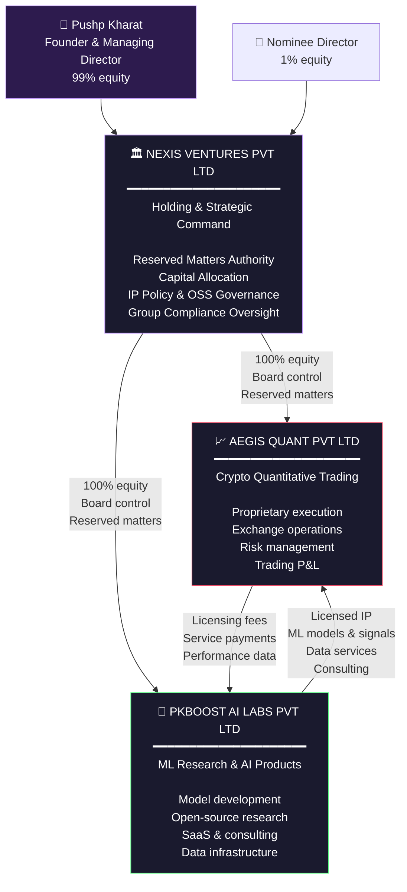
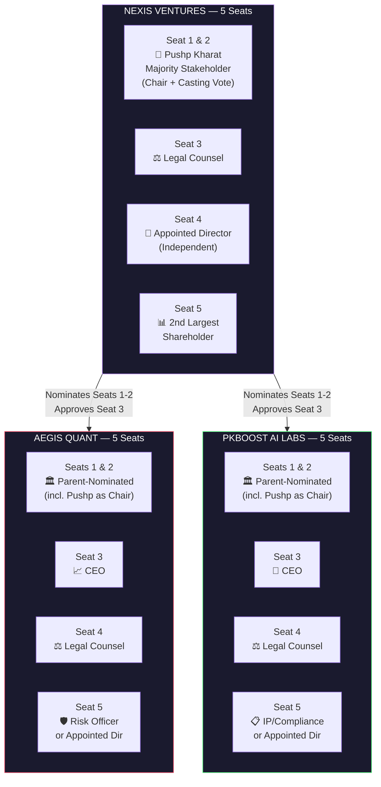
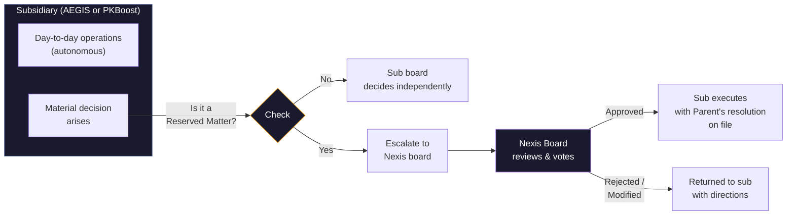
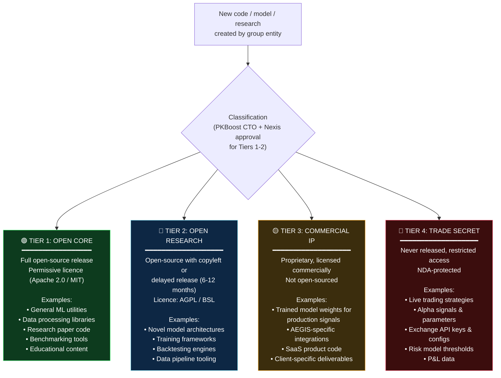
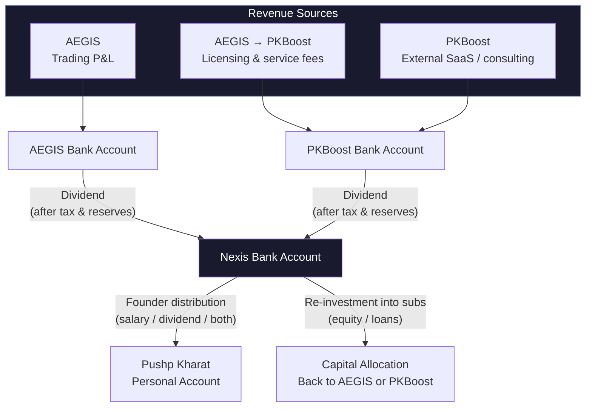

# NEXIS VENTURES — CORPORATE STRUCTURE, GOVERNANCE & COMPLIANCE PROPOSAL

**Version:** 1.0  
**Date:** 12 November 2026  
**Prepared for:** Pushp Kharat, Founder  
**Status:** DRAFT — For review and professional legal validation

---

## RECITALS

1. This proposal establishes the corporate architecture for **Nexis Ventures Private Limited** ("the Parent" or "Nexis"), a holding company to be incorporated under the Companies Act, 2013, with Pushp Kharat as the founder, majority shareholder, and Managing Director.

2. The Parent shall hold 100% of the equity share capital in two wholly-owned subsidiaries:
   - **AEGIS Quant Private Limited** ("AEGIS") — a proprietary cryptocurrency quantitative trading firm; and
   - **PKBoost AI Labs Private Limited** ("PKBoost") — an ML systems research laboratory, AI products company, and technical consulting entity, currently operating as an Udyam-registered MSME.

3. The group operates under an **open-source-first philosophy**, where research and tooling are presumed open-source unless specifically classified otherwise. This philosophy is a core value, not a concession — it drives reputation, talent acquisition, community trust, and long-term ecosystem advantage.

4. The Parent shall exercise **substantive strategic control** over both subsidiaries through reserved matters, board composition, and shareholder rights — ensuring that the founder and any future parent-level stakeholders can direct material decisions at the subsidiary level without undermining operational autonomy.

5. This proposal is designed for a **genuine operating group** with real separation of function, risk, and accountability. It is not a paper structure for tax efficiency.

---

## 1. GROUP STRUCTURE

### 1.1 Ownership Map

### 1.2 Entity Purposes

| Entity | Primary Function | Revenue Sources |
|--------|-----------------|----------------|
| **Nexis Ventures** | Strategic holding, capital allocation, group governance, IP policy, investor relations | Dividends from subs, management fees (if applicable), investment returns |
| **AEGIS Quant** | Proprietary crypto trading, market execution, risk management, treasury operations | Trading P&L (spot, perpetual, arb), exchange rebates |
| **PKBoost AI Labs** | ML research, model development, AI products, SaaS, consulting, open-source stewardship | Licensing fees (from AEGIS), consulting revenue, SaaS subscriptions, grants |

### 1.3 Why Three Entities (Not One or Two)

| Reason | Detail |
|--------|--------|
| **Liability firewall** | A catastrophic trading loss at AEGIS cannot reach PKBoost's IP, revenue, or bank accounts. A lawsuit against PKBoost's open-source code cannot freeze AEGIS's exchange capital. |
| **Separate fundraising** | AI/ML investors go into PKBoost. Trading capital / prop fund investors go into AEGIS. Strategic investors go into Nexis for exposure to both. |
| **Tax regime clarity** | AEGIS profits taxed under Section 115BBH (30% flat on VDA). PKBoost profits taxed under normal corporate rate (25% for small cos). No ambiguity. |
| **Regulatory readiness** | If SEBI or any future regulator requires licensing for crypto trading, AEGIS is the regulated entity. PKBoost continues unaffected as a pure tech company. |
| **Open-source credibility** | PKBoost can maintain a genuine OSS profile. A trading firm open-sourcing code invites scrutiny about strategy leakage. A research lab open-sourcing tools is natural and expected. |

---

## 2. PARENT CONTROL — RESERVED MATTERS & GOVERNANCE POWER

> [!IMPORTANT]
> This section ensures that Nexis Ventures (and therefore you as its majority shareholder) retains **binding decision-making authority** over both subsidiaries on all material matters — without micromanaging day-to-day operations.

### 2.1 Reserved Matters

The following decisions at AEGIS or PKBoost **shall require prior written approval from the Parent's board** (i.e., from Nexis Ventures):

**Financial Controls**
1. Annual budget approval and any expenditure exceeding ₹5,00,000 outside approved budget
2. Any borrowing, debt issuance, or creation of security interest
3. Capital expenditure exceeding ₹2,00,000 in a single transaction
4. Opening or closing of bank accounts
5. Any change in accounting policy or financial year
6. Declaration or payment of dividends

**Strategic Controls**
7. Entry into any new line of business or geographic market
8. Hiring or termination of any C-level role (CTO, COO, CFO) or any employee with CTC > ₹15,00,000/year
9. Any contract with a single-transaction value exceeding ₹10,00,000 or annual value exceeding ₹25,00,000
10. Any related-party transaction (regardless of value)
11. Any joint venture, partnership, or strategic alliance
12. Merger, acquisition, demerger, or winding up

**IP & Open-Source Controls**
13. Classification of any output as proprietary vs. open-source (per Section 5 of this proposal)
14. Any IP assignment, licensing, or transfer to a third party
15. Any open-source release of code, models, datasets, or research papers
16. Selection of open-source licence for any release
17. Any patent filing or trademark registration

**Compliance & Legal**
18. Appointment or removal of statutory auditors
19. Initiation or settlement of any legal proceedings
20. Any amendment to the Articles of Association or Memorandum
21. Any change to the authorised or paid-up share capital

### 2.2 Board Composition — 5-Seat Structure

#### Nexis Ventures Pvt Ltd (Parent) — 5 Seats

| Seat | Held By | Role & Rationale |
|------|---------|-----------------|
| **Seat 1** | Pushp Kharat (Majority Stakeholder) | Managing Director & Chairperson. Strategic vision, final authority on reserved matters. |
| **Seat 2** | Pushp Kharat (Majority Stakeholder) | Second seat ensuring majority control (2 of 5 = 40%). Combined with casting vote as Chair, this guarantees decisive authority on all board resolutions. |
| **Seat 3** | Legal Counsel | Standing legal advisor with board-level visibility. Ensures every resolution is legally sound, related-party transactions are compliant, and regulatory risks are flagged in real time. |
| **Seat 4** | Appointed Director | Independent / nominee director appointed by the board. Brings outside perspective — ideally someone with finance, compliance, or industry domain expertise. |
| **Seat 5** | Second Largest Shareholder | Represents the next largest equity holder (future co-founder, investor, or strategic partner). Ensures minority voice at the table. |

#### AEGIS Quant Pvt Ltd — 5 Seats

| Seat | Held By | Role & Rationale |
|------|---------|-----------------|
| **Seat 1** | Parent-Nominated (Pushp Kharat) | Chairperson. Parent's primary representative. Ensures Nexis's reserved matters authority is exercised at board level. |
| **Seat 2** | Parent-Nominated Director | Second Nexis representative. Guarantees Parent majority (2 of 5). Can be a Nexis-appointed advisor with trading/risk domain expertise. |
| **Seat 3** | CEO of AEGIS Quant | The operational leader — runs day-to-day trading, execution, and exchange relationships. Initially may be Pushp, transitioning to a hired CEO as the team scales. |
| **Seat 4** | Legal Counsel | Standing legal advisor. Critical for a crypto trading entity — monitors regulatory changes, FEMA compliance, exchange T&C shifts, and Section 115BBH developments. |
| **Seat 5** | Risk Management Officer / Appointed Director | **If a dedicated CRO/Risk Officer is hired:** they take this seat — ensuring risk has board-level independence and cannot be overruled by the CEO alone. **If not yet hired:** an appointed director (independent/nominee) fills this seat until the risk function is staffed. |

#### PKBoost AI Labs Pvt Ltd — 5 Seats

| Seat | Held By | Role & Rationale |
|------|---------|-----------------|
| **Seat 1** | Parent-Nominated (Pushp Kharat) | Chairperson. Parent's primary representative. Ensures Nexis's IP and OSS policy decisions flow down. |
| **Seat 2** | Parent-Nominated Director | Second Nexis representative. Guarantees Parent majority (2 of 5). Can be a Nexis-appointed advisor with ML/AI domain expertise. |
| **Seat 3** | CEO of PKBoost AI Labs | Operational leader — drives research agenda, product roadmap, SaaS strategy, and open-source community. Initially may be Pushp, transitioning to a hired CEO/CTO. |
| **Seat 4** | Legal Counsel | Standing legal advisor. Covers IP assignment, OSS licensing compliance, contractor agreements, and client contract review. |
| **Seat 5** | Appointed Director / IP & Compliance Officer | **If a dedicated IP/Compliance lead is hired:** they take this seat — ensuring IP classification and OSS release governance has board-level accountability. **If not yet hired:** an appointed director fills this seat. |

#### Board Governance Rules

**Control & Quorum**
1. The Parent (Nexis) shall hold **at least 2 seats** on each subsidiary board at all times, ensuring majority representation.
2. **Quorum** for any board meeting: minimum 3 directors present, of which **at least 1 must be a Parent-nominated director.** No valid board meeting without Parent representation.
3. The **Chairperson** of each subsidiary shall be a Parent-nominated director and shall hold a **casting vote** in the event of a tie.

**Board Expansion Lock**
4. The total number of board seats shall not be increased beyond 5 for any entity **without the prior unanimous approval of all currently serving board members.**
5. Any proposal to expand the board must be tabled at least 14 days before the board meeting at which it is to be considered.
6. This lock ensures that no single faction — including new investors — can dilute existing board control by unilaterally adding seats.

**Appointment & Removal**
7. Seats 1–2 (Parent-nominated) on subsidiary boards are **non-removable** except by Nexis board resolution.
8. Seat 3 (CEO) appointment and removal requires **Nexis board approval** (Reserved Matter #8).
9. Seat 4 (Legal Counsel) appointment and removal requires majority board vote at the relevant entity + Nexis ratification.
10. Seat 5 (Risk Officer / Appointed Director) appointment and removal follows the same process as Seat 4.

### 2.3 Shareholder Agreement Provisions

A **Shareholders' Agreement** (SHA) shall be executed between Nexis Ventures and each subsidiary, containing:

1. **Affirmative vote rights** — Reserved matters require Nexis's affirmative vote as shareholder
2. **Information rights** — Monthly financial statements, trading reports, risk dashboards, and material event notices delivered to the Parent within 7 days
3. **Drag-along / tag-along** — If the Parent sells its stake, it can drag the subsidiary. If a co-founder (future) sells, the Parent can tag along.
4. **Anti-dilution** — No subsidiary may issue shares, options, or convertible instruments without Parent approval
5. **Non-compete** — Subsidiary directors and key employees shall not compete with any group entity during tenure and for 2 years after

### 2.4 How This Works in Practice

> [!TIP]
> This gives you **strategic control without operational bottleneck.** AEGIS can execute trades, manage risk, and run operations autonomously. But it can't hire a CTO, sign a major contract, open-source a model, or change its capital structure without Nexis's explicit approval.

---

## 3. COMPARTMENTALISATION & OPERATIONAL SEPARATION

### 3.1 Mandatory Separation

Each entity **shall** maintain completely separate:

| Area | What This Means |
|------|----------------|
| **Bank accounts** | No shared accounts. No co-mingling of funds. Inter-company payments only via documented invoices. |
| **Books of account** | Separate accounting software instances or clearly separated ledgers. |
| **Statutory records** | Separate minute books, registers of members, registers of directors. |
| **Code repositories** | Separate GitHub/GitLab organisations. PKBoost repos ≠ AEGIS repos. Shared code only via licensed packages/APIs. |
| **Infrastructure** | Separate cloud accounts (AWS/GCP). Separate monitoring. Separate secrets management. |
| **Data** | AEGIS trading data stays in AEGIS infra. PKBoost accesses it only under the data services SLA, with documented access logs. |
| **Email domains** | `@nexisventures.in` / `@aegisquant.in` / `@pkboost.ai` (or similar) |
| **Contracts** | Each entity signs its own contracts. No entity signs on behalf of another without a documented agency arrangement. |

### 3.2 Shared Resources — How to Handle

Where resources are shared (e.g., office space, founder's time, certain tools), each must be governed by a **written shared services agreement** with:

1. Description of the shared resource
2. Allocation key (e.g., headcount ratio, usage-based, time-tracked)
3. Monthly reconciliation and invoicing
4. Quarterly review of allocation fairness

### 3.3 Personnel Rules

1. Every employee or contractor has **one employing entity.** Period.
2. If PKBoost needs an AEGIS employee's input (or vice versa), it happens under a **formal secondment agreement** with:
   - Defined duration
   - Cost allocation
   - IP assignment for work done during secondment
   - Written approval from both entity boards
3. The founder (Pushp Kharat) shall track time across entities using a reasonable methodology (e.g., weekly time allocation log) to support transfer-pricing documentation.

---

## 4. TAX, GST & FOREIGN EXCHANGE COMPLIANCE

### 4.1 Income Tax

| Entity | Tax Treatment | Rate | Key Provision |
|--------|--------------|------|---------------|
| **AEGIS Quant** | Crypto trading gains | **30% flat** | Section 115BBH, IT Act 1961. No deductions allowed except cost of acquisition. No set-off of losses against other income. |
| **PKBoost AI Labs** | Normal business income | **25%** (for turnover < ₹400 Cr) | Standard corporate rate. R&D deductions under Section 35 may apply. |
| **Nexis Ventures** | Dividend income + management fees | **Slab / 25%** | Inter-corporate dividend taxable in hands of recipient. |

> [!CAUTION]
> **Section 115BBH does NOT allow deduction of expenses** (other than cost of acquisition) against crypto trading income. This means licensing fees paid by AEGIS to PKBoost **may not be deductible** against AEGIS's VDA trading income. This is a critical point your CA must confirm — the tax benefit of the inter-company licensing structure may be limited by 115BBH's no-deduction rule. The licensing arrangement is still valid for commercial purposes, but don't assume it reduces AEGIS's tax bill.

### 4.2 TDS on Crypto

1. **1% TDS** on transfer of Virtual Digital Assets (Section 194S) applies to AEGIS's trades above ₹50,000/year (₹10,000 for specified persons).
2. AEGIS must maintain precise TDS records for every trade.
3. This is deducted by the exchange (for Indian exchanges) or self-reported (for foreign exchanges).

### 4.3 GST on Inter-Company Services

| Service | GST Rate | Who Charges | Who Pays |
|---------|----------|-------------|----------|
| ML model licensing (PKBoost → AEGIS) | **18%** (SAC 997331 — IT software services) | PKBoost | AEGIS |
| Research & consulting (PKBoost → AEGIS) | **18%** (SAC 998312 — management consulting) | PKBoost | AEGIS |
| Management fees (Nexis → subs) | **18%** | Nexis | Each sub |
| Shared infra reimbursement | **18%** (if structured as service; nil if pure reimbursement at actuals with no markup) | Provider | Receiver |

- Each entity requires **separate GST registration** if turnover exceeds ₹20L (services) or ₹40L (goods).
- Inter-company invoices must be GST-compliant with proper SAC codes.
- **Input tax credit:** AEGIS can claim ITC on GST paid to PKBoost, offsetting it against AEGIS's own GST liability (if any). Since trading itself may not attract GST, ITC accumulation could be an issue — your CA should plan for this.

### 4.4 FEMA & Foreign Exchange (Critical for AEGIS)

> [!WARNING]
> AEGIS will trade on **foreign exchanges** (Binance, Bybit, OKX, Hyperliquid). Moving funds from India to these platforms requires FEMA compliance.

| Route | Mechanism | Limits & Rules |
|-------|-----------|---------------|
| **Individual (Pushp)** → Foreign exchange | LRS (Liberalised Remittance Scheme) | \$250,000/person/financial year. **20% TCS** on amounts exceeding ₹7L (refundable against tax). Purpose: "investment in foreign securities" or similar. |
| **Company (AEGIS)** → Foreign exchange | Current Account Transaction | Companies are not covered under LRS. AEGIS must route through **Authorised Dealer (AD) bank** under FEMA current account rules. Prior RBI approval may be needed depending on classification. |
| **Returns** from foreign exchange → India | Inward remittance | Must be reported to AD bank. FIRS (Foreign Inward Remittance Statement) required. |

**Recommended approach:**
1. Open a **current account with an AD bank** that understands crypto (HDFC, ICICI, and some neo-banks have teams for this).
2. Structure outward remittance as **"investment in digital assets for proprietary trading purposes"** with supporting board resolution from AEGIS.
3. Maintain **FEMA-compliant documentation** for every cross-border transfer.
4. Engage a **FEMA specialist** (not just a general CA) to sign off on the structure before first remittance.

### 4.5 FIU-IND Registration

As of March 2024, Virtual Digital Asset Service Providers (VDA SPs) must register with FIU-IND (Financial Intelligence Unit). If AEGIS is trading **proprietary capital only** (not managing client funds), it may not qualify as a VDA SP. However:
- If AEGIS ever manages external capital, FIU registration becomes mandatory.
- Confirm this classification with your lawyer before launch.

---

## 5. OPEN-SOURCE PHILOSOPHY & IP ARCHITECTURE

> [!NOTE]
> Open source is not a side policy — it is a **founding principle** of the group. PKBoost AI Labs exists at the intersection of commercial AI and open research. The IP framework must protect commercial value while enabling genuine, meaningful open-source contributions.

### 5.1 Four-Tier IP Classification

Every piece of code, model, dataset, research output, or tool produced by any group entity shall be classified into **exactly one** of the following tiers before deployment or release:

### 5.2 Classification Rules

1. **Default is Tier 1 (Open).** Unless there is a documented commercial reason to restrict, all PKBoost research outputs default to open-source under Apache 2.0.

2. **Tier escalation requires justification.** Moving something from Tier 1 → Tier 2/3/4 requires a written rationale approved by Nexis board (Reserved Matter #13).

3. **Tier 4 is AEGIS-only.** Only AEGIS Quant produces Tier 4 outputs. PKBoost never holds trade secrets related to live trading strategies.

4. **Boundary rule:** If a piece of work contains elements from multiple tiers, it must be **decomposed** so that the open components can be released independently. No "we can't open-source the data loader because it's in the same repo as the strategy." Separation is mandatory.

### 5.3 Open-Source Governance

| Aspect | Rule |
|--------|------|
| **Licence selection** | Tier 1: Apache 2.0 or MIT. Tier 2: AGPL-3.0 or BSL (Business Source Licence) with conversion date. Nexis board approves licence choice. |
| **CLA (Contributor Licence Agreement)** | All external contributors to PKBoost OSS projects must sign a CLA granting PKBoost sufficient rights to relicense if needed. |
| **Release approval** | Every release goes through a pre-release checklist (Section 5.4). Approval from PKBoost CTO + one Nexis-nominated director. |
| **Community management** | PKBoost maintains public issue trackers, accepts PRs, publishes roadmaps. This is not "throw code over the wall" open-source — it's community-driven. |
| **Attribution** | All OSS releases carry: `© PKBoost AI Labs Pvt Ltd, a Nexis Ventures company` |
| **Upstream contributions** | Contributions to third-party OSS projects (e.g., LightGBM, NautilusTrader) are encouraged and do not require Nexis approval unless they reveal proprietary methodology. |

### 5.4 Pre-Release Checklist

Before any code, model, or dataset is released publicly, confirm:

- [ ] Classified as Tier 1 or Tier 2 (Tier 3/4 cannot be released)
- [ ] No AEGIS trade secrets, strategy parameters, or alpha signals embedded
- [ ] No client confidential information or data
- [ ] No hardcoded API keys, credentials, or internal URLs
- [ ] No third-party code included without compatible licence
- [ ] Licence file and copyright notice present
- [ ] README with description, install instructions, and contribution guide
- [ ] Nexis board approval resolution on file (for first release of a new project)
- [ ] Security review passed (no vulnerabilities in dependencies)

### 5.5 IP Ownership Map

| Creator | Output Type | Owner | Available To |
|---------|------------|-------|-------------|
| PKBoost employee | Research / OSS tools | **PKBoost** | Open (Tier 1/2) or licensed to AEGIS (Tier 3) |
| PKBoost employee | Trained model for AEGIS | **PKBoost** (IP), **AEGIS** (exclusive licence to use) | AEGIS only |
| AEGIS employee | Trading strategy / signals | **AEGIS** | AEGIS only (Tier 4) |
| AEGIS employee | General infra tooling | **AEGIS**, but may be transferred to PKBoost for open-sourcing via IP transfer deed | Depends on classification |
| Pushp Kharat (founder) | Anything | Assigned to the **relevant entity** based on function. Time log determines which entity. | Per classification |
| Contractor | Work product | **Hiring entity** (must be in contract with explicit IP assignment clause per Copyright Act, 1957 §17) | Per classification |

### 5.6 IP Assignment for Pre-Existing Work

> [!IMPORTANT]
> Any ML models, code, research, or tools that Pushp Kharat or PKBoost (MSME) has created **before incorporation** must be formally assigned to PKBoost AI Labs Pvt Ltd via an **IP Assignment Deed.** Without this, the IP legally remains with the creator (individual or MSME), not the new Pvt Ltd entity.

Execute an IP Assignment Deed covering:
1. Schedule of all pre-existing IP (list every model, repo, paper, dataset)
2. Assignment of all rights, title, and interest to PKBoost Pvt Ltd
3. Consideration (can be nominal — ₹1 — but must be documented)
4. Representations that no third party has claims on the IP
5. Stamp duty as applicable in your state

---

## 6. INTER-COMPANY COMMERCIAL ARRANGEMENTS

### 6.1 Agreement Matrix

| Agreement | Between | Purpose | Pricing Basis |
|-----------|---------|---------|--------------|
| **ML Model Licence Agreement** | PKBoost → AEGIS | Licence to use trained ML models for trading signals | Fixed monthly fee + optional performance kicker (% of model-attributed P&L) |
| **Data Services SLA** | PKBoost → AEGIS | Market data pipeline, normalisation, feed handler infra | Cost-plus (actual cost + 15–20% margin) |
| **Research & Consulting Agreement** | PKBoost → AEGIS | Backtesting, strategy research, model evaluation | Time-and-materials (hourly rate × hours logged) |
| **Management Services Agreement** | Nexis → AEGIS & PKBoost | Strategic oversight, governance, compliance coordination, investor relations | Fixed monthly management fee (₹50K–₹1L per sub, reviewed annually) |
| **Shared Services Agreement** | Between all entities | Office space, internet, shared tools | Actual cost allocation by headcount or usage ratio, no markup |

### 6.2 Arm's-Length Pricing Principles

1. Every inter-company charge must reflect what an **unrelated third party** would charge for the same service in the open market.
2. Pricing benchmarked against:
   - Comparable ML consulting firms (for PKBoost → AEGIS consulting rates)
   - SaaS licensing benchmarks (for model licensing fees)
   - Industry surveys for management fee ratios
3. **Transfer Pricing documentation** maintained contemporaneously per Sections 92C–92E, Income-tax Act, 1961.
4. Annual review of all inter-company pricing by statutory auditor.
5. All transactions documented with: written agreement → purchase order / SOW → invoices → delivery confirmation → payment record.

### 6.3 Director Conflict of Interest Protocol

Since Pushp Kharat will serve as director on all three boards:

1. **Disclose interest** under Section 184 of Companies Act, 2013 at the first board meeting of each entity and whenever a new related-party transaction arises.
2. **Abstain from voting** on any resolution approving a related-party transaction where you have interest in both sides — but since you're the sole shareholder/director in practice, the transaction must be **ratified by the Parent** (Nexis board resolution) with the rationale documented.
3. **Appoint at least one independent director or advisor** on each subsidiary board who can provide a disinterested opinion on related-party transactions.
4. All related-party transactions to be reported in **Form AOC-2** annexed to the Board's Report.
5. Comply with **Section 188** of Companies Act, 2013 — for transactions exceeding prescribed thresholds, ordinary resolution of shareholders required (which Nexis passes as 100% shareholder).

---

## 7. RISK CONTROLS & GOVERNANCE SAFEGUARDS

### 7.1 Group-Level Controls

| Control | Owner | Frequency |
|---------|-------|-----------|
| **Compliance calendar** — all statutory filings, board meetings, audit deadlines | Nexis (outsourced to CS firm) | Monthly review |
| **Related-party register** — log of all inter-company transactions with values | Nexis | Updated per transaction, reviewed quarterly |
| **Risk dashboard** — AEGIS trading exposure, P&L, drawdown, risk limits | AEGIS CTO → Nexis MD | Daily automated report |
| **IP register** — all IP assets, their tier classification, and ownership | PKBoost CTO → Nexis | Updated per creation, reviewed quarterly |
| **Cash flow report** — entity-wise bank balances, receivables, payables | Each entity → Nexis | Weekly |

### 7.2 AEGIS-Specific Trading Controls

1. **Kill switch** — hardware and software, tested weekly, accessible to any Nexis-nominated director
2. **Maximum drawdown limit** — if AEGIS hits X% drawdown (set by Nexis board), all trading halts automatically pending board review
3. **Position limits** — per-exchange, per-asset, per-strategy limits approved by Nexis board quarterly
4. **No external capital** without Nexis board approval and FIU/SEBI analysis
5. **Segregation of duties** — the person who develops a strategy cannot be the sole person who deploys it to production

### 7.3 Data Security & Confidentiality

1. All employees and contractors sign **NDAs** with confidentiality obligations surviving 3 years post-termination.
2. Tier 4 (trade secret) information accessible only to AEGIS employees with explicit clearance.
3. PKBoost employees working on AEGIS-related projects sign **supplemental NDAs** covering AEGIS-specific confidential information.
4. Role-based access control (RBAC) on all repositories, cloud accounts, and data stores.
5. Quarterly access review — revoke permissions for anyone who no longer needs them.

---

## 8. DIVIDEND & FUND-FLOW PLANNING

### 8.1 Fund-Flow Architecture

### 8.2 Tax on Fund Flows

| Flow | Tax Treatment |
|------|--------------|
| AEGIS trading profit | 30% flat (Section 115BBH). No deductions. Paid by AEGIS. |
| AEGIS → PKBoost (licensing fee) | Business income for PKBoost, taxed at 25%. GST at 18% charged by PKBoost. **May not be deductible for AEGIS under 115BBH — confirm with CA.** |
| AEGIS → Nexis (dividend) | Taxable in Nexis's hands at applicable corporate rate. TDS at 10% if > ₹5,000/year (Section 194). |
| PKBoost → Nexis (dividend) | Same as above. |
| Nexis → Pushp (salary) | Taxable as salary income at slab rate. TDS by Nexis. Deductible expense for Nexis. |
| Nexis → Pushp (dividend) | Taxable as dividend income at slab rate. TDS at 10% if > ₹5,000. Not deductible for Nexis. |

> [!TIP]
> **Optimal founder compensation mix:** Take a reasonable **salary** from Nexis (deductible for the company, taxed at slab for you — efficient up to ~₹15L–₹20L) + **dividends** for anything above that. Your CA will optimise the exact split based on your total income.

---

## 9. IMPLEMENTATION ROADMAP

### Phase 0: Legal Foundation (Weeks 1–6)

| Week | Action | Owner |
|------|--------|-------|
| 1–2 | **Incorporate Nexis Ventures Pvt Ltd** — MCA filing, DIN for directors, DSC procurement | CS firm |
| 2–3 | **Incorporate AEGIS Quant Pvt Ltd** — Nexis as sole shareholder | CS firm |
| 3–4 | **Convert PKBoost MSME → Pvt Ltd** — Nexis as sole shareholder. Re-register Udyam. | CS firm + CA |
| 3–4 | **Execute IP Assignment Deed** — all pre-existing IP from Pushp/MSME → PKBoost Pvt Ltd | Lawyer |
| 4–5 | **Draft & execute all inter-company agreements** (6 agreements per Section 6.1) | Lawyer |
| 4–5 | **Set up separate bank accounts** for all 3 entities. Open current account with AD bank for AEGIS. | CA + Bank |
| 5–6 | **GST registration** for each entity (if threshold crossed). PAN, TAN for each. | CA |
| 5–6 | **Board resolutions** — adopt reserved matters policy, appoint nominee directors, approve related-party framework | CS firm |
| 6 | **FEMA compliance setup** — AD bank relationship, remittance documentation template, board resolution for outward investment | FEMA specialist |

### Phase 1: Operational Setup (Weeks 7–10)

| Week | Action | Owner |
|------|--------|-------|
| 7 | Separate cloud accounts, GitHub orgs, email domains | You / DevOps |
| 7–8 | RBAC implementation across all systems | You / DevOps |
| 8 | Compliance calendar set up (statutory filings, board meetings, audit deadlines) | CS firm |
| 8–9 | KYB on exchanges (Binance, Bybit, OKX) under AEGIS Quant Pvt Ltd | You |
| 9–10 | IP register created, all existing work classified into 4 tiers | You / PKBoost CTO |
| 10 | **Governance dry run** — simulate a reserved matter approval, related-party transaction flow, OSS release flow | All |

### Phase 2: Commence Operations (Week 11+)

Transition into the **AERIS technical roadmap** (Phase 1 from our earlier plan) with the full corporate structure in place.

---

## 10. ESTIMATED COSTS

| Item | One-Time Cost (INR) | Annual Recurring (INR) |
|------|---------------------|----------------------|
| Nexis Ventures incorporation | ₹15,000–₹30,000 | — |
| AEGIS Quant incorporation | ₹15,000–₹30,000 | — |
| PKBoost conversion to Pvt Ltd | ₹25,000–₹60,000 | — |
| IP Assignment Deed (stamp duty + legal) | ₹20,000–₹50,000 | — |
| Inter-company agreements (6 agreements) | ₹60,000–₹1,20,000 | — |
| FEMA specialist consultation | ₹30,000–₹50,000 | ₹50,000–₹1,00,000 |
| **Total one-time legal/setup** | **₹1,65,000–₹3,40,000** | — |
| ROC annual filings (×3 entities) | — | ₹45,000–₹90,000 |
| Statutory audit (×3 entities) | — | ₹90,000–₹1,80,000 |
| GST returns (×3 entities) | — | ₹72,000–₹1,44,000 |
| IT returns + transfer pricing docs | — | ₹75,000–₹1,50,000 |
| CS retainer (all entities) | — | ₹60,000–₹1,20,000 |
| **Total annual compliance** | — | **₹3,42,000–₹6,84,000** |

---

## 11. CONCLUSION

1. This proposal establishes **Nexis Ventures Private Limited** as the strategic command centre for the group, with binding control over both subsidiaries through reserved matters, board composition, and shareholder agreements.

2. The structure provides **genuine operational separation** — AEGIS's trading risk cannot reach PKBoost's assets, and PKBoost's open-source activity cannot compromise AEGIS's trade secrets.

3. The **open-source-first philosophy** is embedded as a structural principle with a four-tier classification system, not bolted on as an afterthought. Tier 1 (Open Core) is the default. Restriction requires justification.

4. The **tax, GST, FEMA, and transfer-pricing framework** addresses India-specific regulatory realities, including the harsh Section 115BBH regime for crypto, GST on inter-company services, and FEMA compliance for foreign exchange trading.

5. The **parent control mechanisms** ensure that Nexis's stakeholders — currently Pushp Kharat, and in the future any strategic investors at the parent level — have **binding authority** over all material decisions at the subsidiary level, while leaving day-to-day operations autonomous.

6. This structure is designed to **scale.** A third subsidiary (e.g., a SaaS product company, a prop fund, an international entity) can be added under Nexis without restructuring anything.

---

> **This proposal should be reviewed and finalised by a qualified Company Secretary, Chartered Accountant, and corporate lawyer before implementation. It is a strategic framework, not legal advice.**

---

*Nexis Ventures — connecting intelligence to execution.*
