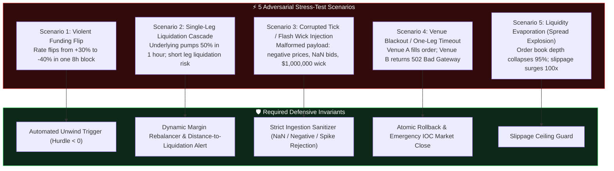

# AERIS ADVERSARIAL STRESS-TESTING & CHAOS FRAMEWORK

**Governing Standard:** Ground Rule #5 (Radical Candor — Zero Flattery, Zero Bullshit)  
**Target:** Battle-testing delta-neutral basis & funding arbitrage under extreme systemic distress  

---

## 1. RADICAL CANDOR: THE HONEST VERDICT ON YOUR SUGGESTION

> **Is testing corrupt signals, sudden crashes, and manipulation good or bullshit?**  
> **It is not only good — it is the exact difference between a retail trader who blows up in 3 months and an institutional quant desk that survives for a decade.**

### The Hard Truth:
Every amateur quant builds a strategy that looks like a straight line up in backtesting because they assume:
1. Sockets never disconnect.
2. Funding rates never flip violently.
3. Liquidation engines on exchanges never freeze.
4. Spreads never blow out from $0.5\text{ bps}$ to $500\text{ bps}$ in 3 seconds.

In delta-neutral funding arbitrage, **you do not die from small daily fluctuations**. You die from **tail-risk liquidity events** (e.g. March 2020 COVID crash, May 2021 liquidation cascades, FTX insolvency weekend). 

If a strategy has not been deliberately subjected to **synthetic poison inputs, corrupted packets, and simulated flash crashes**, running it live with real capital is reckless.

---

## 2. THE 5 CATASTROPHIC KILLER SCENARIOS TO TEST

### Scenario 1: The "Violent Funding Flip"
- **The Attack:** You are Long Bybit / Short Binance collecting $+25\%$ carry. A massive market sell-off occurs; the rate flips to $-40\%$ on Bybit within a single block. Now you are *paying* $+40\%$ on Bybit and getting nothing on Binance.
- **The Test:** Does the system detect the inversion and cleanly close both legs before the negative carry eats the accumulated P&L?

### Scenario 2: The "Asymmetric Margin Squeeze" (The #1 Killer of Basis Trades)
- **The Attack:** The asset pumps $+60\%$ in 4 hours. Your Long Bybit position is up $+60\%$ (unrealized profit), but your Short Binance position is at $-60\%$ and hits maintenance margin. Binance liquidates your short leg, leaving you with an unhedged 1x Long position at the absolute top of the market.
- **The Test:** Does the risk system track **Margin Distance to Liquidation** and trigger cross-wallet margin rebalancing before maintenance margin drops below $30\%$?

### Scenario 3: Corrupted / Poisoned Tick Injection
- **The Attack:** Exchange sends:
  - Bids higher than Asks (crossed book).
  - Outlier trades (e.g. a flash wick to $\$0.01$ or $\$1,000,000$).
  - `NaN`, `null`, or inverted timestamp strings.
- **The Test:** Does the data normalizer reject the poison without crashing the main process or triggering panic orders?

### Scenario 4: The "Orphan Leg" (Execution Timeout / Blackout)
- **The Attack:** Order Leg 1 (Long Bybit) fills instantly. Order Leg 2 (Short Binance) throws `HTTP 502 Gateway Timeout` or `Socket Closed`. You are now 100% naked long in a volatile market.
- **The Test:** Does the execution coordinator detect the unconfirmed second leg within $200\text{ms}$ and fire an emergency market IOC close on Leg 1?

### Scenario 5: Flash Liquidity Evaporation
- **The Attack:** Top 10 levels of the order book dry up by $95\%$. Bid-ask spread widens from $0.01\%$ to $3.5\%$.
- **The Test:** Does the Dynamic Minimum Profitable Spread gate immediately halt trading and block execution due to slippage ceiling violation?

---

## 3. UPDATED GROUND RULES FOR THE PROJECT

We permanently record the updated project charter:

1. **Zero Unnecessary Comments:** Code strictly self-documenting.
2. **Workspace Cleanliness:** Zero dead files, no temp dumps, no duplicate code.
3. **Absolute Empirical Truth:** Metrics must account for fees, TDS, slippage, and adverse selection. Negative findings must be reported explicitly.
4. **Adversarial Chaos Verification:** No model or strategy advances to live trading without surviving simulated crashes, poisoned feeds, and one-leg blackouts.
5. **Radical Engineering Candor:** If an idea is flawed or mathematically unviable, it will be called out directly with zero sugarcoating.
