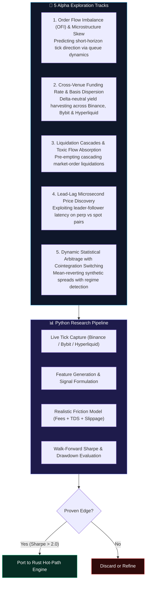

# AERIS ALPHA RESEARCH LAB — SPRINT 1 PLAYGROUND BLUEPRINT

**Phase:** Alpha Generation, Quantitative Discovery & Rapid Prototyping  
**Entity:** PKBoost AI Labs &times; AEGIS Quant  
**Primary Environment:** Python 3.12 (Polars, NumPy, VectorBT, SciPy, WebSockets)  
**Goal:** Prove statistically significant Edge & positive net P&L on historical & live data **before** locking in low-level Rust execution pipelines.

---

## 1. WHY "ALPHA FIRST, RUST SECOND" IS THE RIGHT CALL

> [!TIP]
> **The Golden Rule of Quantitative Trading:**
> *High execution speed multiplies your edge; it does not create it.*
> If a strategy loses 2 bps per trade due to adverse selection, executing it in 500 nanoseconds in Rust just means you lose money faster.

Starting in **Python** for Sprint 1 allows us to:
1. **Iterate at 10x Velocity:** Test 5 distinct alpha hypotheses in 48 hours instead of spending 3 weeks building socket buffers and memory ladders.
2. **True Signal Verification:** Ensure that after exchange taker/maker fees, slippage, and India's 1% TDS, the strategy is mathematically profitable.
3. **Bridge PKBoost & AEGIS:** PKBoost handles the quantitative research, feature engineering, and statistical modeling; AEGIS will then translate the verified winning models into Rust for live execution.

---

## 2. FIVE NOVEL / HIGH-P&L ALPHA AVENUES TO EXPLORE

Instead of standard, saturated vanilla arbitrage, here are 5 high-potential avenues tailored for the current crypto microstructure:



### Track 1: Multi-Level Order Flow Imbalance (OFI)
- **Concept:** Standard BBO (Best Bid/Offer) only looks at level 1. Multi-level OFI measures net order flow shifts across the top 10 depth levels to forecast price movement 500ms to 5 seconds ahead.
- **Why It Works:** Institutional limit orders shift queue weight before market orders execute.
- **Implementation:** Python script reading WebSocket depth deltas, computing rolling OFI vectors, and testing directional predictability.

### Track 2: Cross-Venue Funding Rate & Basis Dispersion (Delta-Neutral)
- **Concept:** Funding rates on perpetuals fluctuate drastically across Binance, Bybit, OKX, and Hyperliquid. 
- **The Edge:** Long Perpetual on Venue A (with negative funding) and Short Perpetual on Venue B (with high positive funding). You collect funding payments every 1h or 8h while holding **zero delta market risk**.
- **Yield Potential:** Historically 20% to 60%+ annualized non-directional APY during high-volatility regimes.

### Track 3: Lead-Lag Dynamics (Perp vs. Spot / Binance vs. Bybit)
- **Concept:** Binance Perpetuals typically lead price discovery during sudden moves. Smaller books (Bybit spot, smaller perpetual pairs) lag by 50ms to 500ms.
- **The Edge:** Monitor the "leader" venue for volume spikes; trigger aggressive maker or IOC taker orders on the "lagging" venue before its order book updates.

### Track 4: Liquidation Cascade Predicate
- **Concept:** Large leveraged positions get liquidated via forced market orders, driving temporary overshoots.
- **The Edge:** Detect liquidation cluster clusters via exchange WebSocket liquidation streams; place resting limit orders deep in the book to absorb the forced liquidations, capturing immediate mean-reversion bounces.

### Track 5: Statistical Arbitrage / Synthetic Triangles
- **Concept:** Cointegration pairs (e.g. SOL/ETH vs. BTC) and triangular cross-currency relationships.
- **The Edge:** Statistical z-score deviations that automatically hedge currency exposure while capturing mean reversion.

---

## 3. PROPOSED SPRINT 1 PLAYGROUND STRUCTURE

We can set up a dedicated `research/` or `playground/` directory right inside the AERIS workspace:

```
d:\Pushp - Do not open without permission\AERIS\
├── playground/
│   ├── requirements.txt            # polars, numpy, scipy, websockets, vectorbt, matplotlib
│   ├── notebooks/                  # Interactive Jupyter exploratory notebooks
│   │   ├── 01_orderbook_ofi_research.ipynb
│   │   ├── 02_cross_venue_funding_arb.ipynb
│   │   └── 03_lead_lag_latency.ipynb
│   ├── collectors/                 # Fast async collectors dumping raw parquet/tick data
│   │   ├── binance_ws.py           # Capture BBO + 20-level depth + trades
│   │   ├── bybit_ws.py             # Capture Bybit v5 stream
│   │   └── hyperliquid_ws.py       # Capture Hyperliquid L1 order flow
│   ├── backtest/                   # Lightweight Python vector backtester
│   │   ├── sim_engine.py           # Realistic queue position & fee model
│   │   └── metrics.py              # Sharpe, Sortino, Max Drawdown, Net P&L after TDS
│   └── strategies/                 # Pure strategy logic implementations
│       ├── ofi_directional.py
│       ├── funding_dispersion.py
│       └── lead_lag_arb.py
```

---

## 4. SPRINT 1 RESEARCH WORKFLOW

1. **Step 1: Setup the Python Research Environment**
   - Use the verified Python 3.12 install to create an isolated virtual environment (`.venv`).
   - Install high-performance research libraries (`polars` for fast tick processing, `websockets`, `httpx`, `scipy`).
2. **Step 2: Stream & Capture Live Microstructure Data**
   - Write a lightweight multi-venue tick & book recorder.
   - Record 24 hours of real, unadulterated live order books and trades across Binance and Bybit for high-volume pairs (BTC-USDT, ETH-USDT, SOL-USDT).
3. **Step 3: Alpha Discovery & Backtesting**
   - Test the 5 alpha models against the captured tick data.
   - Calculate exact Sharpe ratio, win rate, and net P&L after subtracting:
     - 0.02% maker / 0.05% taker fees
     - Estimated slippage
     - India's 1% Section 194S TDS
4. **Step 4: Go/No-Go Gate for Rust Porting**
   - Once a strategy proves consistent positive expectancy and Sharpe > 2.0 in the Python playground, we lock its mathematical formula and port it to the high-performance Rust engine.

---

*Shall we initialize the `playground/` environment with Python 3.12 and start building the data collectors and alpha models?*
