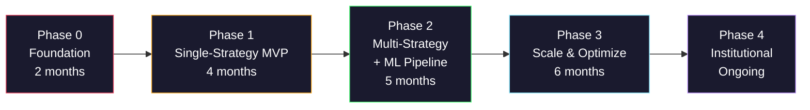
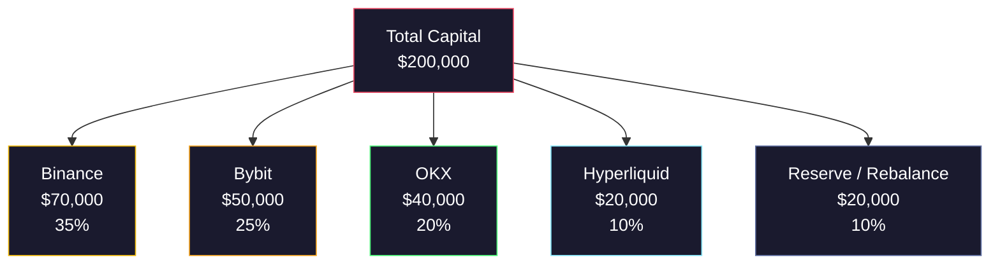
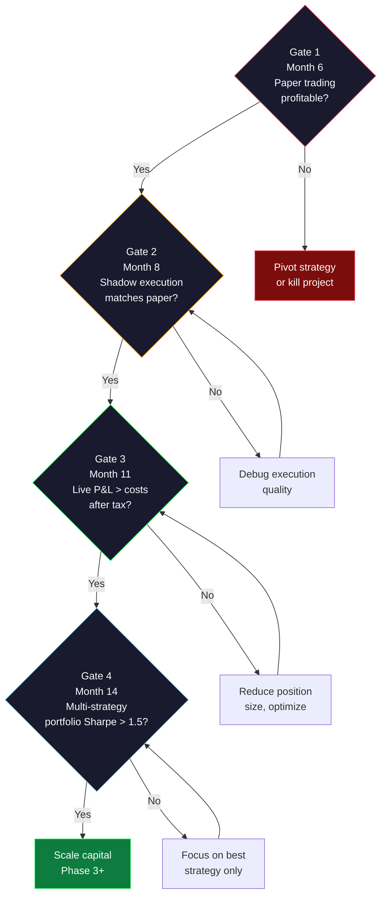

# AERIS — Roadmap, ETA & Investment Blueprint

> A realistic plan for standing up a **small-tier crypto quant shop** from zero to live trading.

---

## High-Level Timeline Overview

**Total ETA to stable live trading:** ~17 months  
**Total ETA to "small quant shop" status:** ~24 months  

---

## Phase 0 — Foundation & Legal (Months 1–2)

> [!IMPORTANT]
> Don't write a single line of trading code before this phase is done. Skipping legal/compliance has killed more quant startups than bad strategies.

| Task | Duration | Details |
|------|----------|---------|
| **Entity formation** | 2–3 weeks | Register an LLP or Private Limited in India. If trading on offshore CEXs, consider a Singapore/Dubai subsidiary for cleaner regulatory posture. |
| **Legal counsel** | Ongoing | Retain a crypto-aware CA + lawyer. India's 30% crypto tax + 1% TDS on transfers (Section 194S) will eat into arb margins — model this into your spread calculations. |
| **Exchange accounts** | 2–4 weeks | KYC/KYB on Binance, Bybit, OKX, Coinbase Advanced, Hyperliquid. Institutional/VIP tiers require applications. |
| **Bank + fiat rails** | 2–4 weeks | Dedicated current account. INR on/off ramps (WazirX/CoinDCX for INR↔USDT, or banking partner for wire transfers). |
| **Infrastructure setup** | 1–2 weeks | Cloud accounts, Git repos, CI/CD, secrets management, monitoring. |

### 💰 Phase 0 Investment

| Item | Cost (INR) | Cost (USD) |
|------|-----------|------------|
| Company registration (LLP/Pvt Ltd) | ₹30,000–₹80,000 | \$350–\$950 |
| Legal retainer (6 months) | ₹3,00,000–₹5,00,000 | \$3,500–\$6,000 |
| CA retainer (crypto-specialized) | ₹1,50,000–₹3,00,000 | \$1,800–\$3,500 |
| Exchange deposits & KYB fees | ₹50,000 | \$600 |
| **Phase 0 Total** | **₹5,30,000–₹9,30,000** | **\$6,250–\$11,050** |

---

## Phase 1 — Single-Strategy MVP (Months 3–6)

### What You're Building
- **One strategy:** Cross-CEX arbitrage (Binance ↔ Bybit) on BTC-USDT & ETH-USDT
- **Core components:** Feed handler → Order book → Spread detector → Risk gateway → Execution → Audit log
- **Language:** Rust for hot path, Python for analytics/monitoring dashboards

### Milestone Breakdown

| Month | Deliverable | Success Criteria |
|-------|------------|-----------------|
| **Month 3** | Feed handlers for Binance + Bybit WebSocket streams. Canonical event format. Order book reconstruction with full-depth snapshot + delta recovery. | Books match exchange UI to ±1 tick on 99.9% of samples |
| **Month 4** | Pre-trade risk gateway (position limits, max order size, loss circuit breakers, kill switch). Execution engine with limit/IOC orders. Adapter pattern for venue abstraction. | Risk gateway blocks 100% of rule-violating orders in unit tests. Kill switch tested and documented. |
| **Month 5** | Cross-CEX spread detector. Dynamic minimum-profitable-spread model (fees + slippage + transfer cost + tax). Paper trading on live data. | Paper P&L is positive after fees over 2+ week window |
| **Month 6** | Shadow execution (real orders, minimum size). Monitoring, alerting, P&L reconciliation. Go/no-go for live. | Shadow execution matches paper trading P&L within 15%. All go-live blockers cleared. |

### 👥 Team for Phase 1

| Role | Count | Monthly Cost (INR) | Notes |
|------|-------|-------------------|-------|
| **You (Founder/Lead)** | 1 | Sweat equity | Architecture, strategy logic, risk design |
| **Rust/Systems Engineer** | 1 | ₹1,50,000–₹2,50,000 | Feed handlers, matching, execution. Hire someone with exchange API or low-latency experience. |
| **DevOps / Infra** | 0.5 (part-time/contract) | ₹75,000–₹1,25,000 | CI/CD, monitoring, cloud infra |
| **Total monthly burn** | — | **₹2,25,000–₹3,75,000** | ~\$2,700–\$4,500/month |

### 🖥️ Infrastructure for Phase 1

| Item | Monthly Cost | Notes |
|------|-------------|-------|
| **Cloud compute** (AWS/GCP — 2× c6i.xlarge or equivalent) | ₹25,000–₹40,000 | One for trading engine, one for monitoring/analytics. Singapore region for Binance/Bybit proximity. |
| **Market data storage** (S3/GCS for tick data) | ₹5,000–₹10,000 | ~50–100 GB/month of raw tick data |
| **Monitoring** (Grafana Cloud / Datadog) | ₹5,000–₹10,000 | Alerting is non-negotiable for a live system |
| **VPN / Dedicated IP** | ₹2,000–₹5,000 | Stable IP for exchange API whitelisting |
| **Total monthly infra** | **₹37,000–₹65,000** | ~\$440–\$780/month |

### 💰 Phase 1 Total Investment

| Category | 4-Month Total (INR) | 4-Month Total (USD) |
|----------|---------------------|---------------------|
| Team | ₹9,00,000–₹15,00,000 | \$10,800–\$18,000 |
| Infrastructure | ₹1,48,000–₹2,60,000 | \$1,760–\$3,120 |
| Software/tools/licenses | ₹50,000 | \$600 |
| **Phase 1 Total** | **₹10,98,000–₹18,10,000** | **\$13,160–\$21,720** |

---

## Phase 2 — Multi-Strategy + ML Pipeline (Months 7–11)

### What You're Adding
- **Strategy 2:** Spot/Perpetual funding rate arbitrage
- **Strategy 3:** Statistical arbitrage (pairs/cointegration on correlated assets)
- **Exchange 3:** OKX or Coinbase Advanced
- **ML pipeline:** LightGBM/XGBoost for short-horizon spread prediction
- **Backtesting framework:** Deterministic replay on historical tick data

### Milestone Breakdown

| Month | Deliverable |
|-------|------------|
| **Month 7–8** | Funding rate arb strategy. OKX adapter. Historical data ingestion pipeline (6+ months of tick data). |
| **Month 9** | Backtesting framework with deterministic replay. Validate cross-CEX arb strategy historically. Stat arb signal research. |
| **Month 10** | ML feature engineering. LightGBM model for spread prediction. Train/serve contract with shadow scoring. Benchmark ML vs rule-based signals. |
| **Month 11** | Stat arb strategy live on paper. ML model in shadow mode alongside rule-based. Portfolio-level risk aggregation across all strategies. |

### 👥 Team Growth

| Role | Count | Added Cost (INR/month) |
|------|-------|----------------------|
| **Quant/ML Engineer** | 1 | ₹2,00,000–₹3,50,000 |
| **Data Engineer** (can be part-time) | 0.5 | ₹75,000–₹1,25,000 |
| **Total monthly burn (full team)** | — | **₹5,00,000–₹8,50,000** (~\$6,000–\$10,200) |

### 💰 Phase 2 Total Investment

| Category | 5-Month Total (INR) | 5-Month Total (USD) |
|----------|---------------------|---------------------|
| Team | ₹25,00,000–₹42,50,000 | \$30,000–\$51,000 |
| Infrastructure (scaled up) | ₹3,00,000–₹5,00,000 | \$3,600–\$6,000 |
| Historical data purchases | ₹1,00,000–₹2,00,000 | \$1,200–\$2,400 |
| **Phase 2 Total** | **₹29,00,000–₹49,50,000** | **\$34,800–\$59,400** |

---

## Phase 3 — Scale & Optimize (Months 12–17)

### What You're Adding
- **DEX integration** (Hyperliquid first — it's a CLOB, not AMM, so easier)
- **DEX/CEX arbitrage** strategy
- **Performance optimization:** Profiling-driven. Migrate hot paths to zero-alloc Rust. Evaluate AF_XDP for network I/O.
- **Treasury system:** Multi-exchange capital allocation optimizer. Automated rebalancing.
- **Compliance hardening:** Audit trails, regulatory reporting, INR tax automation.

### 👥 Team at Scale

| Role | Count | Notes |
|------|-------|-------|
| You (CTO/Lead) | 1 | Strategy + architecture |
| Rust/Systems Engineers | 2 | Core engine + performance |
| Quant/ML Engineer | 1 | Signals + model retraining |
| Data Engineer | 1 | Pipelines + storage + replay |
| DevOps | 1 | Infra + monitoring + deploys |
| **Total headcount** | **6** | |
| **Monthly burn** | **₹10,00,000–₹16,00,000** | ~\$12,000–\$19,200/month |

### 💰 Phase 3 Total Investment

| Category | 6-Month Total (INR) | 6-Month Total (USD) |
|----------|---------------------|---------------------|
| Team | ₹60,00,000–₹96,00,000 | \$72,000–\$115,200 |
| Infrastructure (bare metal / co-lo evaluation) | ₹6,00,000–₹10,00,000 | \$7,200–\$12,000 |
| Legal / compliance / audit | ₹3,00,000–₹5,00,000 | \$3,600–\$6,000 |
| **Phase 3 Total** | **₹69,00,000–₹1,11,00,000** | **\$82,800–\$133,200** |

---

## Phase 4 — Institutional (Month 18+)

This is the "only if Phase 3 is profitable" phase:
- FPGA evaluation for exchange connectivity
- DPDK/RDMA kernel bypass networking
- External capital (prop trading fund structure)
- Additional exchanges (Kraken, dYdX, more DEXs)
- Market making as a strategy (requires exchange maker agreements)

**Cost:** ₹2–5 Cr+ (\$250K–\$600K+) annually. Only pursue if risk-adjusted returns justify it.

---

## 💰 Trading Capital Requirements

> [!CAUTION]
> This is **separate** from operational/development costs. This is money on the exchanges, at risk.

| Tier | Capital Deployed | Expected Monthly Return | Strategy Coverage |
|------|-----------------|------------------------|-------------------|
| **Minimum Viable** | ₹25,00,000–₹50,00,000 (\$30K–\$60K) | 1–3% (before tax) | Single cross-CEX arb pair |
| **Small Tier** | ₹1,00,00,000–₹2,50,00,000 (\$120K–\$300K) | 2–5% (before tax) | Multi-strategy, 3 exchanges |
| **Competitive** | ₹5,00,00,000+ (\$600K+) | Variable | Full strategy suite, DEX + CEX |

### Capital Distribution (Small Tier Example — \$200K)

> [!WARNING]
> **India-specific tax impact on arb margins:**
> - 30% flat tax on crypto gains (no loss offset across asset classes)
> - 1% TDS on every transfer above ₹50,000
> - This means a 5 bps arb spread effectively becomes ~3.5 bps after tax
> - Your dynamic min-profitable-spread model **must** include tax as a first-class cost

---

## 📊 Total Investment Summary

| Phase | Duration | Operational Cost (INR) | Operational Cost (USD) |
|-------|----------|----------------------|----------------------|
| Phase 0 — Foundation | 2 months | ₹5,30,000–₹9,30,000 | \$6,250–\$11,050 |
| Phase 1 — MVP | 4 months | ₹10,98,000–₹18,10,000 | \$13,160–\$21,720 |
| Phase 2 — Multi-Strategy | 5 months | ₹29,00,000–₹49,50,000 | \$34,800–\$59,400 |
| Phase 3 — Scale | 6 months | ₹69,00,000–₹1,11,00,000 | \$82,800–\$133,200 |
| **Total Operational (17 months)** | **17 months** | **₹1,14,28,000–₹1,87,90,000** | **\$137,010–\$225,370** |

| Capital Type | Amount (INR) | Amount (USD) |
|-------------|-------------|-------------|
| **Trading capital (small tier)** | ₹1,00,00,000–₹2,50,00,000 | \$120,000–\$300,000 |
| **Operational + Trading Total** | **₹2,14,28,000–₹4,37,90,000** | **\$257,010–\$525,370** |

---

## 🎯 Realistic "Lean Start" Budget

If you want to **minimize burn and self-fund**, here's the absolute minimum to get to first live trade:

| Item | Cost |
|------|------|
| Just you (founder) building for 6 months | Sweat equity |
| 1 part-time Rust contractor (Phase 1 only) | ₹6,00,000 (\$7,200) |
| Cloud infra for 6 months | ₹2,00,000 (\$2,400) |
| Legal + compliance basics | ₹3,00,000 (\$3,600) |
| Trading capital (minimum viable) | ₹25,00,000 (\$30,000) |
| **Lean Start Total** | **₹36,00,000 (~\$43,200)** |

> [!TIP]
> The lean path takes longer (~9–12 months to first live trade instead of 6), but it lets you **validate the idea before committing big capital**. If cross-CEX arb is profitable at \$30K, you have proof to either scale your own capital or raise from investors.

---

## Key Milestones & Go/No-Go Gates

---

## Final Reality Check

| Factor | Optimistic | Realistic | Pessimistic |
|--------|-----------|-----------|-------------|
| Time to first live trade | 5 months | 8 months | 14 months |
| Time to consistent profitability | 8 months | 14 months | 24+ months |
| Monthly ROI on trading capital | 3–5% | 1–2% | Negative |
| Chance of being profitable Year 1 | — | ~40–50% | — |
| Break-even on operational costs | 10 months | 18 months | Never |

> [!NOTE]
> These numbers assume crypto markets maintain current volatility and liquidity. A sustained bear market with low volume compresses arb spreads significantly. Conversely, high-volatility periods (like post-halving cycles) can be extremely profitable for arb strategies.

---

*Want me to drill into any specific phase, build a detailed Gantt chart, or start scaffolding the Phase 0/1 project structure?*
