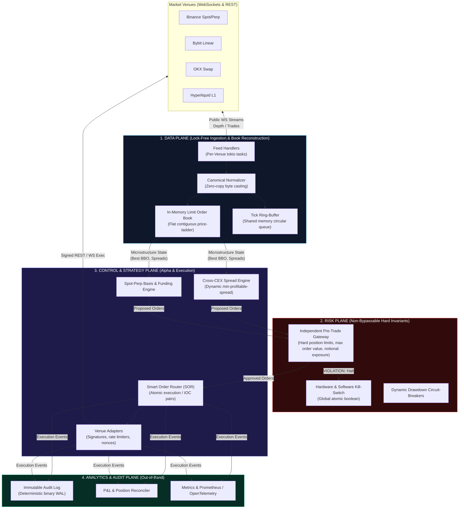
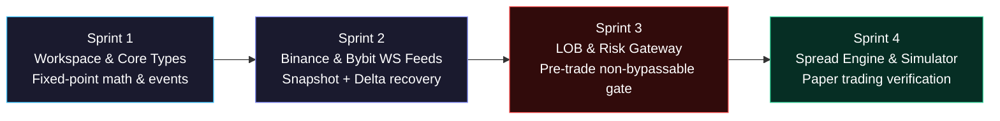

# AERIS QUANT ENGINE — TECHNICAL ARCHITECTURE & IMPLEMENTATION PROPOSAL

**Document:** Software Architecture Specification & Language Decision  
**Target:** Institutional-Grade Cryptocurrency Execution & Arbitrage Platform  
**Entity:** AEGIS Quant Pvt Ltd (Subsidiary of Nexis Ventures)  
**Author:** Engineering Team  
**Status:** PROPOSAL — For Engineering Sign-off  

---

## 1. LANGUAGE EVALUATION: RUST VS. C/C++

When building a high-frequency / low-latency trading engine where financial execution and risk safety are critical, both **Rust** and **Modern C++ (C++20/23)** are premier choices. Below is a rigorous engineering evaluation tailored to our specific team size, operational constraints, and execution requirements:

```mermaid
flowchart TD
    subgraph Criteria["Evaluation Criteria"]
        C1["Raw Latency & Predictability"]
        C2["Memory Safety & Concurrency"]
        C3["Development Velocity & Tooling"]
        C4["Crypto Async Ecosystem (WS/TLS)"]
        C5["Maintenance & Attack Surface"]
    end

    subgraph Rust["🦀 Rust (Recommended)"]
        R1["Deterministic zero-cost abstractions\nLLVM backend matches C++\nZero allocator control"]
        R2["Fearless concurrency (Send/Sync)\nZero data races & memory bugs at compile time\nNo segfaults in production"]
        R3["First-class build/package system (Cargo)\nBuilt-in testing, benchmarking, doc-tests\nStrict formatting (clippy/fmt)"]
        R4["Tokio/Tungstenite/Rustls\nDominates high-throughput async crypto I/O\nExcellent simd/crossbeam support"]
        R5["Guaranteed absence of undefined behavior\nRefactoring confidence is unmatched"]
    end

    subgraph CPP["⚡ Modern C++ (C++20)"]
        CP1["Historic TradFi standard\nNanosecond-level micro-optimizations\nWidest FPGA/vendor SDK support"]
        CP2["Manual pointer tracking\nData races caught only at runtime/sanitizers\nBuffer overflows possible"]
        CP3["Fragmented build systems (CMake, vcpkg, Conan)\nDependency management overhead"]
        CP4["Beast/Boost.Asio\nExtremely fast but verbose and error-prone\nSlower iterative API prototyping"]
        CP5["High cognitive overhead during review\nUndefined behavior risks capital loss"]
    end

    C1 --> R1 & CP1
    C2 --> R2 & CP2
    C3 --> R3 & CP3
    C4 --> R4 & CP4
    C5 --> R5 & CP5

    style Rust fill:#0d2818,stroke:#50fa7b,color:#fff
    style CPP fill:#1a1a2e,stroke:#6272a4,color:#fff
```



### Comprehensive Comparison Matrix

| Factor | Rust (1.80+) | C++ (C++20 / C++23) | Impact on AERIS |
|---|---|---|---|
| **Hot-Path Execution Latency** | Sub-microsecond (LLVM optimized, zero-allocation data structures) | Nanosecond / Sub-microsecond (LLVM / GCC / MSVC) | **Tie**: For crypto network round-trips (10–50ms to exchanges), internal engine tick-to-trade of 1–5µs in either language is 1000x faster than network jitter. |
| **Concurrency & Thread Safety** | Compile-time guaranteed `Send`/`Sync` safety; zero data races | Developer discipline, runtime sanitizers (TSan, ASan), mutex deadlocks | **Winner: Rust**. In multi-threaded book management and execution feeds, data races cause ghost fills and phantom balances. |
| **Async WebSocket & Networking** | `tokio`, `tungstenite`, `rustls`, `bytes` (industry gold standard for crypto) | `boost.beast`, `boost.asio`, `libwebsockets` | **Winner: Rust**. Crypto feeds require hundreds of concurrent WebSocket multiplexers. Rust's async runtime is vastly more productive and robust. |
| **Production Crash Risk** | Compile-time prevention of use-after-free, double-free, dangling references | High risk of undefined behavior / segfault on edge-case data | **Winner: Rust**. A crash during a volatile liquidation wave leaves orphan positions unhedged. |
| **Toolchain on Host** | Native `rustc 1.95.0` & `cargo` already verified and working on environment | Requires MSVC build tools / CMake / Ninja configuration | **Winner: Rust**. Zero setup friction. |

### 🎯 Recommendation: **Rust as Core Engine**

> [!IMPORTANT]
> **Decision:** Build the entire trading engine, market-data feeds, matching engine, and non-bypassable risk gateway in **Rust**.
> - **Performance:** Rust compiles down via LLVM to the exact same machine code as C++.
> - **Capital Protection:** In crypto trading, memory leaks or concurrency bugs can drain millions in seconds. Rust's type system enforces invariant checks at compile time.
> - **C Foreign Function Interface (FFI):** Should we later adopt hardware acceleration (Solarflare OpenOnload, DPDK, or FPGA kernel drivers in Tier 3), Rust has zero-overhead C-ABI compatibility to bind directly to C/C++ native drivers.

---

## 2. THE FOUR-PLANE SYSTEM ARCHITECTURE

Per the institutional specifications in your architectural dossier, AERIS avoids the monolithic "single Python bot" trap by strictly separating the system into **four isolated planes**:



### Detailed Plane Breakdown

#### 1. Data Plane (`aeris-data`)
- **Feed Handlers:** Asynchronous WebSocket readers running on dedicated thread cores. Auto-reconnect with exponential backoff and heartbeat tracking.
- **Deterministic Order Book Reconstruction:**
  - Maintains full depth by buffering deltas while fetching REST snapshots.
  - State machine checks sequence IDs (`lastUpdateId` / `u`, `U`, `pu`). Any dropped packet instantly triggers a full book reset and resynchronization.
- **Zero-Allocation Price Ladder:** Instead of heavy heap-allocated tree maps (`BTreeMap`), the hot path uses pre-allocated flat arrays with tick index offsets for sub-microsecond updates.

#### 2. Risk Plane (`aeris-risk`) — Non-Bypassable
- **Position & Capital Gate:** Every order generated by any strategy **must** pass through this gate before reaching the network adapter. There is no physical code path from strategy to venue that skips risk.
- **Checks executed in &lt;100 nanoseconds:**
  - Max single order size (base & quote notional)
  - Max gross portfolio exposure across all venues
  - Per-asset concentration limits
  - Maximum allowable price deviation from current BBO (fat-finger protection)
  - Short-window message rate throttling (exchange ban prevention)
- **Hardware & Software Kill-Switch:** Atomic flags that trigger immediate order cancellation and socket closure across all venues upon critical trigger.

#### 3. Control & Execution Plane (`aeris-engine`)
- **Dynamic Minimum Profitable Spread Gate:**
  $$\text{Spread}_{\text{min}} = \text{Fee}_{\text{buy}} + \text{Fee}_{\text{sell}} + \text{Slippage}_{\text{est}} + \text{TDS}_{1\%} + \text{Tax}_{\text{buffer}} + \text{TargetProfit}$$
  No arbitrage order is submitted unless the visible executable book liquidity guarantees net profitability after all exchange fees and Indian tax overheads.
- **Atomic Two-Legged Order Router:** Implements IOC (Immediate-Or-Cancel) / FOK (Fill-Or-Kill) logic to eliminate leg risk in cross-venue arbitrage.

#### 4. Analytics & Audit Plane (`aeris-telemetry` & `aeris-ledger`)
- **Event-Sourced Write-Ahead Log (WAL):** Every market tick, risk validation, strategy decision, and exchange response is serialized to an append-only binary log with monotonic nanosecond timestamps.
- **Deterministic Replay:** Allows replaying any historical trading day tick-for-tick through the exact strategy binaries to verify backtest realism.

---

## 3. PROPOSED CARGO WORKSPACE STRUCTURE

```
d:\Pushp - Do not open without permission\AERIS\
├── Cargo.toml                       # Master workspace manifest
├── Cargo.lock
├── README.md
├── crates/
│   ├── aeris-core/                  # Primitive types (Price, Qty, Symbol, OrderId, Timestamp)
│   │   ├── Cargo.toml
│   │   └── src/
│   │       ├── currency.rs          # Fixed-point price/qty (no IEEE 754 float inaccuracies)
│   │       ├── events.rs            # Canonical MarketEvent & OrderEvent envelopes
│   │       └── venue.rs             # Venue identifiers & metadata
│   │
│   ├── aeris-book/                  # High-performance Limit Order Book
│   │   ├── Cargo.toml
│   │   └── src/
│   │       ├── ladder.rs            # Fast cache-friendly price ladder
│   │       ├── state.rs             # Recovery state machine (snapshot + delta buffering)
│   │       └── level.rs             # Price levels and volume aggregation
│   │
│   ├── aeris-venue/                 # Exchange adapters (WebSocket & REST)
│   │   ├── Cargo.toml
│   │   └── src/
│   │       ├── binance/             # Binance Spot & Futures stream/execution client
│   │       ├── bybit/               # Bybit v5 Unified API client
│   │       ├── okx/                 # OKX v5 client
│   │       ├── hyperliquid/         # Hyperliquid L1 bridge
│   │       └── traits.rs            # VenueAdapter contract (normalize venue differences)
│   │
│   ├── aeris-risk/                  # Non-bypassable Pre-Trade Risk Gateway
│   │   ├── Cargo.toml
│   │   └── src/
│   │       ├── gateway.rs           # Strict inline pre-trade validator
│   │       ├── limits.rs            # Notional, concentration & fat-finger limits
│   │       └── circuit_breaker.rs   # Drawdown, loss rate, & kill-switch controls
│   │
│   ├── aeris-strategy/              # Alpha models & Arbitrage engines
│   │   ├── Cargo.toml
│   │   └── src/
│   │       ├── spread_gate.rs       # Dynamic minimum profitable spread predicate
│   │       ├── cross_cex.rs         # Two-legged cross-exchange arbitrage
│   │       └── funding_arb.rs       # Spot-Perpetual cash & carry engine
│   │
│   ├── aeris-execution/             # Smart Order Router & Execution State Machine
│   │   ├── Cargo.toml
│   │   └── src/
│   │       ├── router.rs            # Simultaneous two-leg order coordination
│   │       └── tracker.rs           # Live order state tracker & execution reconciliation
│   │
│   └── aeris-telemetry/             # Observability, WAL logging, and metrics
│       ├── Cargo.toml
│       └── src/
│           ├── wal.rs               # Lock-free append-only binary audit log
│           └── metrics.rs           # Prometheus metrics exporter & latency timers
│
└── bins/
    ├── aeris-node/                  # Live production trading daemon
    │   ├── Cargo.toml
    │   └── src/main.rs
    └── aeris-backtest/              # Deterministic simulation & historical replay tool
        ├── Cargo.toml
        └── src/main.rs
```

---

## 4. CRITICAL LOW-LATENCY DESIGN DECISIONS

### Fixed-Point Math over Floating Point (`f64`)
- **Problem:** Floating-point numbers (`f32`/`f64`) suffer from rounding errors (`0.1 + 0.2 != 0.3`) which cause silent order rejection from exchanges (e.g. tick-size violations).
- **Solution:** Use **fixed-point integer arithmetic** (e.g. integer ticks and lots, or scaled `u64`/`i64` integers). 100% precision, zero float inaccuracies, and faster integer instruction pipelines on CPU.

### Zero-Allocation Hot Path
- Standard collections like `String`, `Vec`, or `HashMap` trigger heap allocations (`malloc`), which cause unpredictable operating system pauses.
- **Rule:** Zero heap allocations during live market ticks. Data buffers, queues, and order books are pre-allocated at startup with fixed capacities using `arrayvec`, `smallvec`, or static ring-buffers.

### Thread Affinity & Core Pinning (Phase 1 Ready)
- Critical feed-handler and matching threads are pinned to dedicated physical CPU cores (`core_affinity`) to avoid context switching and cache invalidation.

---

## 5. PHASE 1 IMPLEMENTATION PLAN (STEP-BY-STEP)



### Sprint 1: Foundation (Days 1–5)
1. Initialize Git repository and multi-crate Cargo workspace.
2. Implement `aeris-core`:
   - Fixed-point price/volume types (`Fixed8` / `ScaledInt`).
   - Standard event envelopes (`MarketEvent`, `OrderBookUpdate`, `TradeEvent`).
   - High-resolution timestamping via hardware counters (`minstant` / `rdtsc`).

### Sprint 2: Market Data Engine (Days 6–15)
1. Implement `aeris-venue` Binance & Bybit public WebSocket feeds:
   - Binance `@depth@100ms` & `trade` streams.
   - Bybit v5 `orderbook.50` & `publicTrade` streams.
2. Build the snapshot recovery state machine:
   - Queue live stream deltas in a buffer.
   - Fetch REST snapshot concurrently.
   - Replay queued deltas where `delta.sequence_id >= snapshot.last_update_id`.
   - Validate checksum/sequence continuity.

### Sprint 3: Order Book & Pre-Trade Risk Gateway (Days 16–25)
1. Implement `aeris-book` contiguous level ladder.
2. Implement `aeris-risk`:
   - Independent validator verifying every order proposal against hard invariants.
   - Position tracking, max order size, and kill-switch state.
   - Comprehensive unit and fuzz testing for zero bypass possibilities.

### Sprint 4: Spread Gate & Paper Execution (Days 26–35)
1. Implement `aeris-strategy` cross-CEX spread detector:
   - Calculates real-time spread across Binance and Bybit order books.
   - Evaluates the dynamic minimum profitable spread gate (including 1% TDS and exchange fee structures).
2. Wire up paper trading mode:
   - Logs simulated fills against real live top-of-book depth with latency penalties.
   - Continuous 24/7 dry-run testing.

---

## 6. RECOMMENDATION & NEXT ACTIONS

1. **Approve Rust as the official implementation language:**
   - Toolchain already active (`rustc 1.95.0`, `cargo 1.95.0`).
   - Gives us safety, modern async networking, and raw C++ equivalent performance.
2. **Authorize initialization of the `AERIS` Cargo workspace** to begin Sprint 1.

---
*Ready to scaffold the repository and write the master workspace manifest.*
