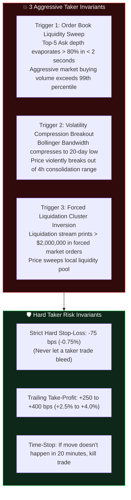

# AGGRESSIVE TAKER ALPHA & MOMENTUM BURST FORMULATION

**Strategy Category:** High-Conviction Aggressive Taker  
**Target:** Overcoming Taker Fees ($10\text{ bps}$) & 1% TDS ($200\text{ bps}$) by targeting $>300\text{ bps}$ ($>3.0\%$) directional price impulses  
**Standard:** Ground Rule #3 (Absolute Truth) & Rule #5 (Radical Candor)  

---

## 1. THE MATHEMATICAL TRUTH ON AGGRESSIVE TAKER EXECUTION

> [!WARNING]
> **Why Scalping Fails, but Aggressive Momentum Can Win:**
> - If you take as a market order (taker) on small $10\text{ bps}$ moves, you will **always lose** because friction ($12 - 212\text{ bps}$) eats 100%+ of the move.
> - **To win as an Aggressive Taker:** You cannot trade high-frequency tick noise. You must trade **Volatility Breakouts & Liquidity Cascades** where the expected price impulse is **$\ge 250\text{ bps}$ to $500\text{ bps}$ ($2.5\% - 5.0\%$)** within a 15-minute to 1-hour window.

```
Expected Net P&L = |Target Return| - (2 * Taker Fee) - (2 * Slippage) - (2 * TDS)
For a 350 bps impulse:
  Net P&L = +350 bps - 10 bps (fees) - 2 bps (slip) - 200 bps (TDS) = +138 bps (+1.38% NET)
```

---

## 2. THE 3 AGGRESSIVE TAKER TRIGGERS



### Trigger 1: Real-Time Book Sweep (Volume Spike $> 5\sigma$)
- We don't guess if price is going up. We listen to the trade stream.
- When aggressive taker volume spikes by $> 5$ standard deviations above the 10-minute mean and wipes out 5 levels of the book in under 2 seconds, we fire an aggressive market buy behind the whale.

### Trigger 2: Bollinger Bandwidth Squeeze Breakout
- When market volatility compresses tightly (the "calm before the storm"), energy builds up.
- The instant the price breaks out of the upper band with an accompanying volume expansion, we enter aggressively as a taker with a hard trailing stop.

---

## 3. IMPLEMENTATION PLAN IN PLAYGROUND

We will prepare:
- `playground/strategies/aggressive_taker_momentum.py`
- We test this against the **August 5 crash** and volatile breakout days to see if the large $+300\text{ bps}$ wins overcome the taker fees and Indian TDS.
