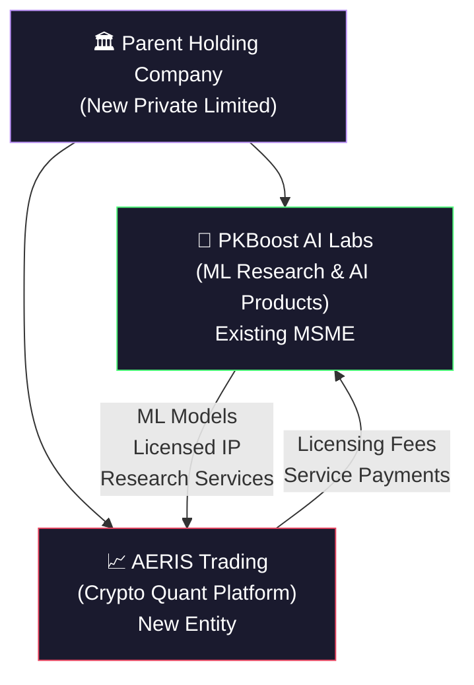
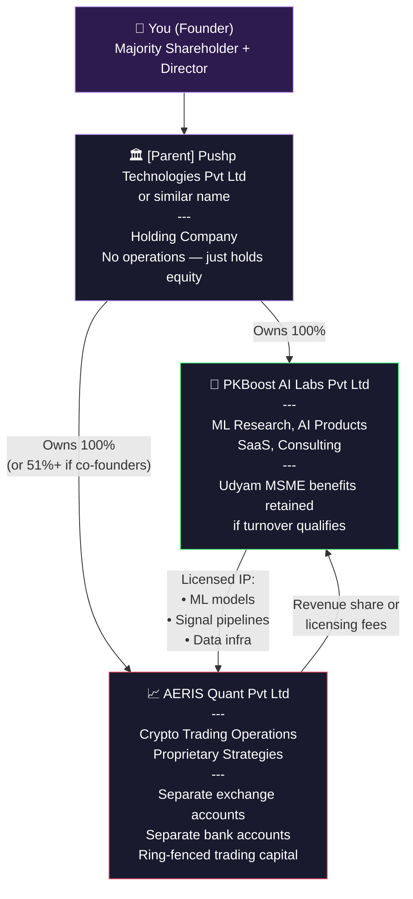
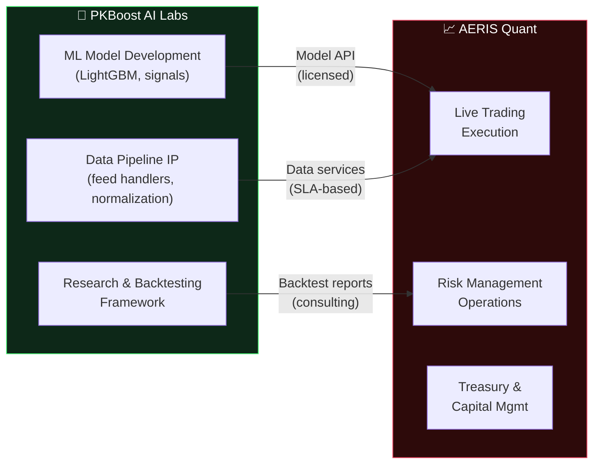

# Corporate Structuring — Parent Company + Subsidiaries

> Incorporating **PKBoost AI Labs** (existing MSME) and **AERIS** (quant trading) under a unified holding structure.

---

## Why This Makes Sense

This is actually a very smart move, and here's why — your PDFs literally reference **"PKBoost and machine-learning integration"** as a core component of AERIS. So you've already designed the two entities to work together:

**PKBoost builds the brains. AERIS trades with them. The parent owns both.**

---

## Structure Options

### Option A: Private Limited as Parent (⭐ Recommended)

| Aspect | Details |
|--------|---------|
| **Structure** | New Private Limited Company (holding co) → owns/controls PKBoost + AERIS |
| **Why best** | Cleanest for investors, limited liability isolation, credible for institutional partnerships |
| **MSME handling** | PKBoost continues as-is under Udyam, or converts to a Pvt Ltd subsidiary |
| **AERIS** | Incorporated as a separate Pvt Ltd subsidiary |

### Option B: LLP as Parent

| Aspect | Details |
|--------|---------|
| **Structure** | New LLP holding → subsidiaries |
| **Why not** | LLPs can't easily hold equity in Pvt Ltd companies. Investors won't fund an LLP. LLPs can't issue ESOPs. Not suitable if you ever want external capital. |

### Option C: One Big Private Limited (Flat)

| Aspect | Details |
|--------|---------|
| **Structure** | Convert PKBoost to Pvt Ltd, run AERIS as a division inside it |
| **Why not** | Zero liability isolation. If AERIS blows up on a bad trade, PKBoost's assets are exposed. Messy accounting. Can't bring in separate investors for each venture. |

---

## ⭐ Recommended Structure (Detailed)

---

## Why Separate Entities Under a Holding Company?

### 1. Liability Firewall 🛡️

> [!CAUTION]
> Crypto trading carries **tail risk** — a flash crash, exchange hack, or API bug could cause significant losses. If AERIS is a separate Pvt Ltd, those losses are **contained to AERIS's assets only**. PKBoost's IP, revenue, and bank accounts are untouchable.

### 2. Separate Fundraising Paths 💰

| Entity | Investor Profile |
|--------|-----------------|
| **PKBoost AI Labs** | AI/ML VCs, SaaS angels, govt grants (MSME/Startup India) |
| **AERIS Quant** | Prop trading capital, HNIs, crypto-native funds |
| **Parent (Holding)** | Strategic investors who want exposure to both |

You can raise for one without diluting the other.

### 3. Tax Optimization (Legal) 📋

| Flow | Tax Treatment |
|------|--------------|
| PKBoost licenses ML models to AERIS | Taxed as **business income** at PKBoost (25% corp tax for small companies). Deductible expense for AERIS. |
| AERIS trading profits | Crypto gains taxed at **30% flat** (Section 115BBH) — no way around this. |
| Dividends from subs → Parent | **Tax-free** in the hands of the holding company (Section 10(34) abolished, but inter-corporate dividends have nuances — your CA will structure this). |
| Parent distributes to you | Taxed as dividend income in your hands at slab rate. |

> [!TIP]
> By routing ML costs through PKBoost as a **service/licensing fee** to AERIS, AERIS gets a legitimate expense deduction, reducing its effective tax on trading profits. PKBoost earns revenue that's taxed at a lower corporate rate (25% vs 30% crypto tax). **This is legal tax-efficient structuring, not avoidance.**

### 4. MSME Benefits Preservation 🏭

PKBoost AI Labs can **retain Udyam registration and MSME benefits** (priority lending, govt subsidies, lower fees) as long as:
- Its investment in plant & machinery stays below ₹50 Cr
- Turnover stays below ₹250 Cr
- It operates as a separate entity (not merged into a non-MSME parent)

If you convert PKBoost from proprietorship/partnership to Pvt Ltd, you'll need to **re-register under Udyam** with the new entity's details. The benefits carry over.

---

## IP & Revenue Flow Design

This is where it gets clever, given your architecture:

| Revenue Stream | From → To | Structure |
|---------------|-----------|-----------|
| ML model licensing | AERIS → PKBoost | Monthly license fee (e.g., ₹1–3L/month) or % of AUM |
| Data infrastructure services | AERIS → PKBoost | SLA-based service agreement |
| Research & backtesting | AERIS → PKBoost | Project-based consulting invoices |
| External AI/ML clients | Clients → PKBoost | PKBoost's own independent revenue (SaaS, consulting) |
| Trading profits | Markets → AERIS | Proprietary trading P&L |

> [!IMPORTANT]
> All inter-company transactions must be at **arm's length pricing** (what you'd charge an unrelated third party). Your CA will document this with a **Transfer Pricing policy** — it's mandatory if the holding structure crosses certain thresholds, and good practice regardless.

---

## Step-by-Step Incorporation Roadmap

### Step 1: Incorporate the Holding Company (Week 1–3)
- **Name:** Something broad — e.g., "Pushp Technologies Private Limited" or "PKB Holdings Private Limited"
- **Type:** Private Limited Company under Companies Act, 2013
- **Directors:** You (mandatory) + 1 more (family member / co-founder / nominee)
- **Authorized capital:** ₹10–25 lakhs (can increase later)
- **Registered office:** Your current address works
- **Cost:** ₹8,000–₹15,000 (govt fees) + ₹10,000–₹20,000 (CS/CA fees)

### Step 2: Incorporate AERIS as a Subsidiary (Week 2–4)
- **Name:** "AERIS Quant Private Limited" or "AERIS Trading Technologies Private Limited"
- **Shareholder:** Holding company holds 100% (or 51%+ if co-founders get direct equity)
- **Directors:** You + at least 1 more
- **Object clause:** Include "proprietary trading in digital assets / cryptocurrency" explicitly
- **Cost:** Same as above — ₹18,000–₹35,000

### Step 3: Restructure PKBoost (Week 3–6)
This depends on PKBoost's current form:

| Current Form | Action | Complexity |
|-------------|--------|------------|
| **Sole proprietorship** with Udyam | Convert to Pvt Ltd, holding company subscribes to shares. Re-register Udyam. | Medium |
| **Partnership** | Convert to Pvt Ltd via Section 366 of Companies Act, or wind down and transfer assets. | Medium-High |
| **Already a Pvt Ltd** | Holding company acquires shares via share transfer/allotment. Simplest. | Low |

### Step 4: Inter-Company Agreements (Week 4–6)
- IP licensing agreement (PKBoost → AERIS)
- Data services SLA
- Shared services agreement (if sharing office/infra)
- Transfer pricing documentation

### Step 5: Bank Accounts & Compliance (Week 5–8)
- Separate current accounts for each entity
- GST registration for each (if applicable)
- AERIS: Exchange KYB under the new entity
- Update Udyam registration for PKBoost if restructured

---

## 💰 Incorporation Costs Summary

| Item | Cost (INR) | Cost (USD) |
|------|-----------|------------|
| Holding company incorporation | ₹18,000–₹35,000 | \$215–\$420 |
| AERIS Pvt Ltd incorporation | ₹18,000–₹35,000 | \$215–\$420 |
| PKBoost conversion/restructuring | ₹25,000–₹60,000 | \$300–\$720 |
| Legal agreements (inter-company) | ₹50,000–₹1,00,000 | \$600–\$1,200 |
| CA/CS professional fees | ₹30,000–₹60,000 | \$360–\$720 |
| Stamp duty & misc govt fees | ₹20,000–₹40,000 | \$240–\$480 |
| **Total incorporation cost** | **₹1,61,000–₹3,30,000** | **\$1,930–\$3,960** |

---

## Ongoing Compliance (Annual)

| Obligation | Applies To | Estimated Annual Cost |
|-----------|-----------|----------------------|
| ROC annual filing (MGT-7, AOC-4) | Each Pvt Ltd (×3 entities) | ₹15,000–₹30,000 per entity |
| Statutory audit | Each Pvt Ltd | ₹30,000–₹60,000 per entity |
| GST returns (if applicable) | Each entity | ₹24,000–₹48,000 per entity |
| Income tax returns | Each entity | ₹15,000–₹25,000 per entity |
| Transfer pricing documentation | Holding + subs | ₹50,000–₹1,00,000 |
| **Total annual compliance** | **All entities** | **₹3,00,000–₹6,00,000** (~\$3,600–\$7,200) |

> [!NOTE]
> Three Pvt Ltd companies = 3× the compliance. This is the trade-off for liability isolation and structural flexibility. A good CS firm can handle all three as a package deal for less than the sum of individual costs.

---

## ⚠️ Crypto-Specific Regulatory Notes

1. **RBI stance:** RBI hasn't banned crypto, but banks are skittish. AERIS should have **dedicated banking relationships** — consider neobanks or crypto-friendly banks.

2. **FIU-IND registration:** As of 2024, crypto exchanges and VDA service providers must register with FIU-IND. If AERIS is trading on its own account (proprietary), you may not need this — but **confirm with your lawyer**. If you ever manage external capital, FIU registration becomes mandatory.

3. **SEBI:** Currently doesn't regulate crypto. But if regulations come, having a clean corporate structure with proper audit trails will be a massive advantage over informal setups.

4. **FEMA:** Cross-border fund transfers for trading on foreign exchanges need FEMA compliance. Your CA must structure the outward remittance under LRS (Liberalised Remittance Scheme — \$250K/person/year) or through the company's trade account.

---

> [!TIP]
> **Startup India Registration:** Register the holding company under Startup India (DPIIT recognition) if it qualifies — you'll get tax holidays under Section 80-IAC (3 consecutive years out of 10), angel tax exemption, and faster IP processing. The holding company needs to be < 10 years old and < ₹100 Cr turnover.

---

*Want me to draft the object clauses for the MOA, or should we get back to scaffolding the AERIS codebase?*
