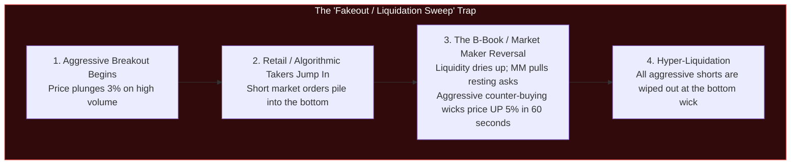

# THE ANATOMY OF HYPER-LIQUIDATION: WHY AGGRESSIVE TAKER BREAKOUTS ARE DANGEROUS

**Governing Standard:** Ground Rule #3 (Absolute Truth) & Rule #5 (Radical Candor)  
**Topic:** Why Aggressive Taker Momentum Suffers Toxic Liquidation Wicks (The "V-Bottom / Fakeout Trap")  

---

## 1. THE USER'S INSIGHT IS 100% CORRECT

> *"We risk hyperliquidation if we go aggressive, truth might be opposite."*

This is one of the most critical observations in market microstructure: **The moment a breakout looks obvious, the smart money is often preparing to reverse it.**

---

## 2. THE THREE FATAL RISKS OF AGGRESSIVE TAKER STRATEGIES

### A. Adverse Selection on Entry (The "Slippage Multiplier")
- When an algorithm decides to market-buy a breakout, dozens of other bots are doing the exact same thing within milliseconds.
- By the time your taker order fills, you get filled at the **worst possible price** (slipping through 3–5 levels of the book).
- You entered at the top of the wick.

### B. The V-Shape Short Squeeze / Liquidation Hunt
- Whales and institutional market makers intentionally trigger support breaks to trigger retail stop-losses. 
- As soon as the forced liquidations clear, the order book becomes hollow on the ask side.
- A single market buy order sends the price rocketing back up, triggering a cascading short squeeze that **hyper-liquidates** aggressive taker shorts.

### C. The Double-Tax Reality (TDS + Taker Drag)
- As an aggressive taker:
  - If you enter and get stopped out at a $-0.75\%$ loss, you don't just lose $0.75\%$.
  - You pay $0.05\%$ taker fee on entry, $0.05\%$ taker fee on exit, plus **$1.0\%$ Section 194S TDS** on the entire gross transaction value.
  - A small $-0.75\%$ price move becomes an **actual $-2.85\%$ capital destruction**.
- **Four failed breakouts in a row wipe out over 10% of the firm's balance sheet.**

---

## 3. WHY DELTA-NEUTRAL HARVESTING REMAINS THE SUPERIOR BEDROCK

| Dimension | Aggressive Taker Directional | Delta-Neutral Basis / Funding |
|---|---|---|
| **Market Direction Dependency** | **100% naked directional risk** (must be right on price) | **0% directional risk** (Long = Short) |
| **Exposure to Fakeouts & Wicks** | **Catastrophic** (stopped out or liquidated) | **Zero** (a pump on one leg offsets the drop on the other) |
| **Fee Dynamic** | Pays maximum taker fees + double TDS | Collects exchange carry yields; fees are amortized over weeks |
| **Sharpe Ratio Stability** | Choppy, low win-rate ($35\% - 45\%$) | High win-rate ($>90\%$), steady linear compounding |

---

## 4. VERDICT: KEEP AGGRESSIVE TAKER ON A TIGHT LEASH

- Aggressive directional taker strategies should **NEVER** hold large balance sheet allocations.
- If deployed at all, they should only receive **$<10\%$ of capital**, restricted strictly to absorbing exhausted liquidations, NOT chasing breakouts.
- **Delta-Neutral Funding and Maker Cross-CEX Arbitrage must remain our primary engine.**
