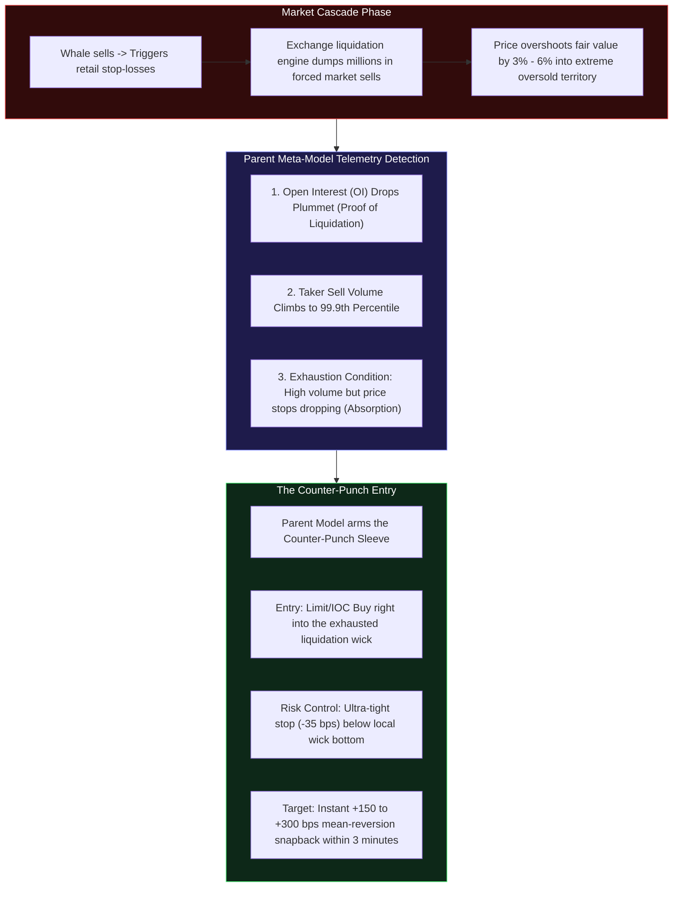

# THE COUNTER-PUNCH: EXPLOITING HYPER-LIQUIDATION TO OUR ADVANTAGE

**Strategy Name:** Liquidation Exhaustion & Counter-Punch Engine  
**Governing Authority:** The Parent Meta-Model (`MetaAllocator`)  
**Core Mechanism:** Letting the aggressive crowd get liquidated, detecting the exact exhaustion tick, and counter-punching with an asymmetric risk-reward trade  

---

## 1. TURNING LIQUIDATION FROM A THREAT INTO AN EDGE

> [!TIP]
> **The Key Microstructural Insight:**
> Don't chase the liquidation cascade as a follower. **Wait for the forced market orders to exhaust the book, then step in as the liquidity provider to capture the violent mean-reversion bounce.**

---

## 2. THE 3 EXACT MATHEMATICAL CONDITIONS REQUIRED BY THE META-MODEL

The Parent Model will **only** authorize this sleeve when all 3 metrics align simultaneously:

1. **Massive Open Interest (OI) Wipeout:**
   - OI must decline by $>3\%$ in less than 5 minutes. This mathematically proves positions were **forcibly liquidated by exchange risk engines**, not orderly profit-taking.
2. **Cumulative Volume Delta (CVD) Divergence:**
   - Aggressive taker selling volume is hitting record highs, **yet price has stopped making lower lows on the 1-second book**.
   - This proves institutional limit buyers are absorbing every sell order at the bottom.
3. **Asymmetric Risk-to-Reward Ratio ($> 4:1$):**
   - **Stop-Loss:** Placed directly under the liquidation wick low ($-35\text{ bps}$).
   - **Take-Profit:** Placed at the pre-crash fair value ($+180\text{ bps}$).
   - Even with Indian TDS and taker fees, a $4:1$ payoff ratio only needs a $35\%$ win rate to be highly profitable.

---

## 3. STRICT GUARDS ENFORCED BY THE PARENT MODEL

1. **Cap Allocation at 15% Maximum:** Never allow the Counter-Punch sleeve to risk the firm's balance sheet.
2. **Hard Time-Stop (3 Minutes):** If the violent snapback bounce does not occur within 180 seconds, the trade is killed at market immediately. No holding, no hoping.
3. **Cooldown Penalty:** If stopped out, the strategy enters a mandatory 30-minute freeze on that asset to prevent revenge trading.
