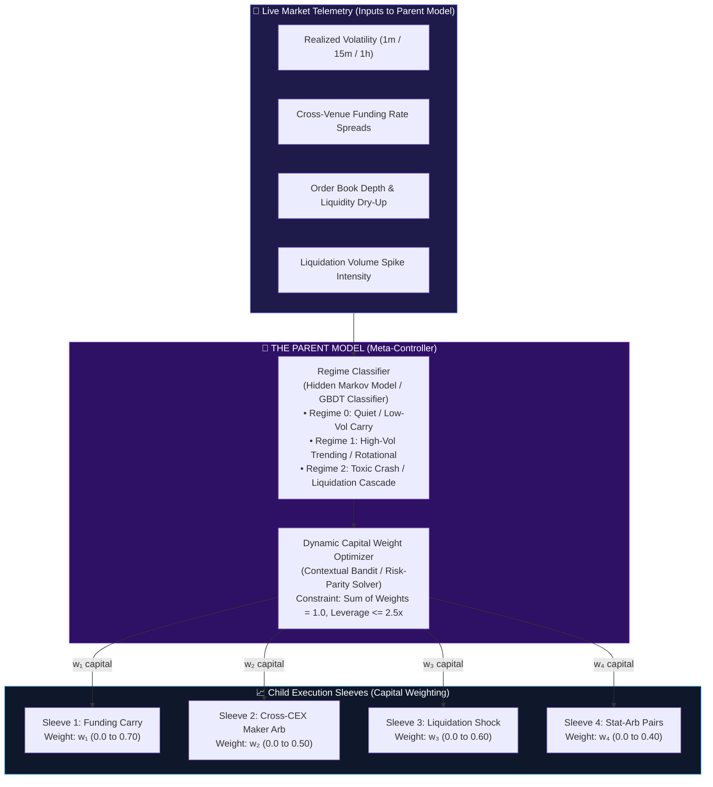

# AERIS META-ALLOCATOR: HIERARCHICAL REINFORCEMENT & REGIME-SWITCHING PARENT MODEL

**Role:** The "Master Quant" / Chief Investment Officer (CIO) Model  
**Entity:** PKBoost AI Labs (Model Research) &times; AEGIS Quant (Execution)  
**Objective:** Dynamically shift capital weights across strategy sleeves in real time based on detected market state  

---

## 1. THE HIERARCHICAL ARCHITECTURE

Instead of treating all strategies equally with fixed 25% capital allocations, a **Parent Meta-Model** sits on top of all sleeves.

---

## 2. HOW THE PARENT MODEL SHIFTS WEIGHTS ACROSS REGIMES

| Detected Market State | Telemetry Trigger | Parent Model Action | Capital Allocation Weights |
|---|---|---|---|
| **Regime 0: Low-Vol Sideways** | Volatility $\le 1.0\%$, Spreads tight, zero liquidations | Pump maximum capital into carry yields | **Funding Carry: 70%** Maker Arb: 20% Stat-Arb: 10% Liquidation: 0% |
| **Regime 1: Normal Volatility** | Volatility $1.0\% - 3.5\%$, sector divergence (SOL vs ETH) | Emphasize spread arbitrage and pairs reversion | Funding Carry: 35% **Maker Arb: 35%** **Stat-Arb: 30%** Liquidation: 0% |
| **Regime 2: Black Swan / Crash** | Volatility $> 5\%$, Liquidation bursts, spreads widening | Cut carry to minimum, arm the liquidation scoopers | Funding Carry: 20% (hedged) Maker Arb: 0% (blocked by spreads) Stat-Arb: 0% **Liquidation Shock: 80%** |

---

## 3. WHY A PARENT MODEL IS MATHEMATICALLY SUPERIOR

1. **Eliminates Dead Capital Drag:**
   - In quiet markets, having 25% of your money parked in an idle Liquidation bot is a waste of capital. The Parent Model shifts that capital into Funding Carry so every dollar earns yield 24/7.
2. **Instant Defense During Crashes:**
   - When the Parent Model detects an incoming liquidation cascade, it instantly cuts exposure to market-making and pairs trading (which get slaughtered by adverse selection during crashes) and routes all dry powder to scoop up the panic wicks.
3. **Where Machine Learning Actually Shines:**
   - Earlier, we proved that using ML to predict 1-second price direction is ruined by fees.
   - **Predicting Market Regimes on 15-minute / 1-hour intervals has a massive Signal-to-Noise Ratio.** GBDT classifiers and Hidden Markov Models excel at classifying whether the market is entering a high-volatility regime.

---

## 4. PROPOSED PLAYGROUND IMPLEMENTATION

We can build this directly into the playground under `playground/strategies/meta_allocator.py`:
- **Inputs:** Rolling volatility, liquidation stream intensity, funding rate dispersion, and order book bid-ask spread.
- **Output:** A vector of normalized capital weights $\vec{w} = [w_{\text{funding}}, w_{\text{maker}}, w_{\text{liquidation}}, w_{\text{stat\_arb}}]$.
- **Enforcement:** Passes the weights down to the central risk gate.
