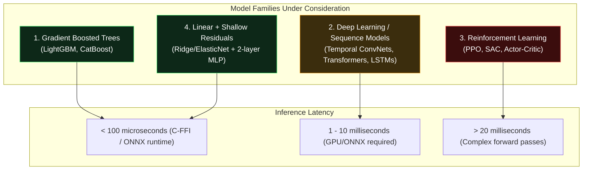

# UNBIASED MODEL EVALUATION: ML vs. DL vs. RL FOR HIGH-FREQUENCY CRYPTO TRADING

**Context:** Sub-second to 10-second alpha generation on cryptocurrency order books and perpetuals  
**Standard:** Strict empirical truth — evaluating signal-to-noise ratio, latency budget, non-stationarity, and implementation risk  

---

## 1. THE THREE HARD CONSTRAINTS OF THE PRICE DOMAIN

Before picking any architecture, every model must survive three non-negotiable physical constraints:

1. **Inference Latency Budget ($\le 2\text{ms}$):**
   - For tick-level or queue-position trading, if your forward pass takes $50\text{ms}$, the order book state you predicted has already cleared. The quote is gone.
2. **Abysmal Signal-to-Noise Ratio (SNR $< 0.05$):**
   - Financial tick data is $\sim 95\%+$ noise. Deep architectures with millions of parameters are notorious for fitting the noise of the training regime and failing out-of-sample.
3. **Severe Non-Stationarity (Regime Shifts):**
   - Market microstructure distributions mutate weekly (volatility spikes, fee tier adjustments, liquidation cascades). Models that cannot be retrained or adapted continuously in seconds become toxic liabilities.

---

## 2. THE CANDIDATE ARCHITECTURES EVALUATED



---

## 3. OBJECTIVE COMPARISON MATRIX

| Dimension | GBDTs (LightGBM / CatBoost) | Deep Learning (TCN / DeepLOB / Transformers) | Reinforcement Learning (PPO / SAC) | Linear / Ridge / OFI |
|---|---|---|---|---|
| **Inference Latency (CPU single-core)** | **$10\mu\text{s} - 80\mu\text{s}$** (via Treelite / ONNX / native C) | $2\text{ms} - 25\text{ms}$ (PyTorch / TensorRT) | $15\text{ms} - 80\text{ms}$ (Actor forward pass) | **$< 1\mu\text{s}$** (Vector dot-product) |
| **Tabular Microstructure Performance** | **State of the Art** on structured numerical features (spreads, depth ratios, OFI) | Inferior on tabular unless data volume is massive ($>10^8$ ticks) | Terrible on raw tabular state spaces | Baseline (Linear only) |
| **Overfitting Risk on Low SNR** | Low–Moderate (constrained by tree depth `max_depth=4-6`) | **Extremely High** (memorizes spurious microstructure patterns) | **Catastrophic** (overfits simulated environment dynamics) | Zero |
| **Retraining Velocity** | **Seconds to Minutes** (easy rolling walk-forward updates) | Hours to Days (requires GPU cluster) | Days to Weeks (sample inefficient) | Real-time (Recursive Least Squares) |
| **Execution Reality** | Predicts directional probability / expected delta return | Predicts next price step or class | Tries to learn policy, fill probability, and sizing simultaneously | Explains immediate pressure |

---

## 4. DETAILED BREAKDOWN BY FAMILY

### A. Reinforcement Learning (RL) — Verdict: **DO NOT USE FOR ALPHA GENERATION**
- **The Pitch:** An autonomous agent learns optimal quotes and actions by interacting directly with an environment.
- **The Harsh Reality:**
  1. **Simulation-to-Reality Gap (Sim2Real):** RL requires millions of trial-and-error interactions. Because you cannot train on real money, you must train in a simulator. But simulators *cannot accurately model exchange matching queues, adverse selection, or counterparty reactions*. The agent learns to exploit artifacts in your simulator, not the real market.
  2. **Non-Convergence:** In non-stationary environments where transition probabilities $P(s' | s, a)$ change constantly, RL policies oscillate wildly and suffer catastrophic forgetting.
- **Where RL actually works:** Execution optimization (e.g., optimal liquidation sizing like TWAP/VWAP scheduling over 2 hours). **For short-horizon alpha generation, it is an academic trap.**

---

### B. Deep Learning (Transformers / LSTMs / DeepLOB) — Verdict: **SECONDARY / SELECTIVE USE ONLY**
- **The Pitch:** Raw order book levels ($L_1 \dots L_{50}$) fed into 1D/2D Convolutional layers (like the Oxford DeepLOB paper) or Temporal Attention layers to capture complex temporal dependencies.
- **The Harsh Reality:**
  1. **Latency Overhead:** Evaluating a multi-layer Transformer or deep CNN takes milliseconds. In sub-second market making or latency arbitrage, that latency destroys the Sharpe ratio.
  2. **Transformer Attention is Overkill:** Market microstructure memory decays exponentially. Ticks from 15 minutes ago have virtually zero impact on the next 200ms price change. Attention mechanisms waste compute searching for long-range relationships that are pure noise.
- **Where Deep Learning makes sense:**
  - **Temporal Convolutional Networks (TCN):** Much lighter than Transformers, causal, dilated convolutions that evaluate in $<1\text{ms}$.
  - Horizon: 5-second to 60-second predictions, NOT sub-second tick prediction.

---

### C. Gradient Boosted Decision Trees (LightGBM / CatBoost) — Verdict: **PRIMARY WORKHORSE (TIER 1)**
- **Why It Consistently Wins in Production Quants:**
  1. **Dominance on Tabular Features:** Order book state is tabular by nature (Bid Size 1-5, Ask Size 1-5, OFI z-scores, trade volume imbalance, funding delta). Academic studies consistently show GBDTs outperform Deep Learning on tabular financial data.
  2. **Blazing Fast Inference:** Compiled via tools like **Treelite** or converted to flat C code, a 100-tree LightGBM model with `max_depth=5` evaluates in **less than 30 microseconds** on a single CPU core without GPU overhead.
  3. **Feature Robustness:** Naturally handles non-linearities, missing ticks, outliers, and varying feature scales without delicate normalization schemes.
  4. **Rapid Rolling Retraining:** Can be retrained on a rolling 24-hour window in under 60 seconds, adapting cleanly to regime shifts.

---

### D. Regularized Linear Models (Ridge / ElasticNet / RLS) — Verdict: **MANDATORY BASELINE**
- **Why You Need This:**
  - Microsecond-level dot product ($\vec{w} \cdot \vec{x}$).
  - Recursive Least Squares (RLS) can update weights online on every single incoming tick with zero offline retraining step.
  - If a complex ML model cannot beat a well-regularized Ridge regression after subtracting taker fees and slippage, the complex model has zero real edge.

---

## 5. THE RECOMMENDED PRODUCTION MODEL LADDER

Based strictly on empirical evidence, here is the exact ladder to implement:

```
[Level 1: Baseline]
Linear / Ridge Regression on Multi-Level OFI Vectors
   │  Execution: < 1 µs | Proves whether linear microstructure signal exists
   ▼
[Level 2: Primary Workhorse]
LightGBM / CatBoost (Shallow Depth: max_depth=4 to 6, n_estimators=100-200)
   │  Features: OFI vectors, signed taker volume, spread skew, volatility ratios
   │  Execution: ~20-50 µs | Captures non-linear feature interactions without overfitting
   ▼
[Level 3: Deep Challenger (Only after Level 2 is profitable)]
Lightweight Causal TCN (Temporal Convolutional Network) via ONNX Runtime
   │  Features: Raw sequential order book snapshots over rolling 50-tick windows
   │  Execution: ~1-2 ms | Benchmarked against Level 2; adopted ONLY if Sharpe improves > 0.5
```

---

## SUMMARY RECOMMENDATION

1. **Start with LightGBM / CatBoost** as our core machine learning architecture for the playground.
2. **Benchmark every model against a linear Ridge baseline.**
3. **Reject Reinforcement Learning (RL)** for directional alpha — it is plagued by simulator-overfitting and latency bottlenecks.
4. **Reserve Deep Learning (TCN)** strictly as an out-of-sample challenger for multi-second horizons once the tabular tree models are profitable.
