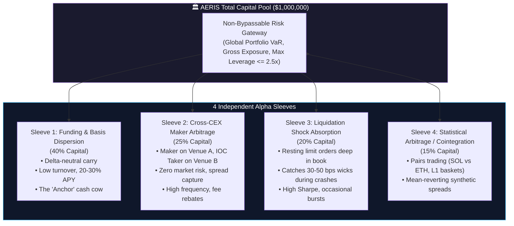

# AERIS MULTI-STRATEGY PORTFOLIO ENGINE & SHARED RISK MATRIX

**Target:** Multi-Strategy Orchestration across Uncorrelated Alpha Sleeves  
**Entity:** AEGIS Quant Pvt Ltd &times; PKBoost AI Labs  
**Core Problem:** Multiple strategies sharing one balance sheet without blowing up the firm  

---

## 1. THE 4 UNCORRELATED STRATEGY SLEEVES

A real quant shop never bets the entire balance sheet on one trade. The portfolio is split into **uncorrelated sleeves** that thrive in different market conditions:



### Why Multi-Strategy Wins Over Single-Strategy:
- When the market is **flat/boring**: Sleeves 2 and 3 do nothing, but **Sleeve 1 (Funding)** churns out steady 25% annualized carry.
- When a **violent crash hits**: Sleeve 1 sits safely in its 2x hedge, while **Sleeve 3 (Liquidation Absorption)** makes a massive payday scooping up panicked forced liquidations at a 5% discount.
- When an asset **diverges from its sector**: **Sleeve 4 (Stat Arb)** captures the mean-reversion snap.

---

## 2. THE MULTI-STRATEGY RISK TRAP (AND HOW TO PREVENT IT)

> [!CAUTION]
> **The #1 Danger of Running Multiple Strategies:**
> Strategy A goes Long 10 BTC. Strategy B independently goes Short 10 BTC.
> - **The Retail Mistake:** Paying fees on 20 BTC worth of volume to achieve **0 BTC net exposure**.
> - **The Cross-Margin Trap:** Strategy A makes money on Bybit, while Strategy B loses collateral on Binance. If they don't share real-time state, Strategy B gets liquidated even though Strategy A has plenty of profit.

### The Solution: Centralized Portfolio State Machine
In AERIS, strategies do **not** talk directly to exchange APIs. All orders pass through a **centralized portfolio clearing engine**:

```
[Strategy 1]    [Strategy 2]    [Strategy 3]    [Strategy 4]
     │               │               │               │
     └───────────────┼───────────────┴───────────────┘
                     ▼
       ┌───────────────────────────┐
       │   INTERNAL NETTING ENGINE  │ ──> Nets offsetting orders internally (zero fees!)
       └─────────────┬─────────────┘
                     ▼
       ┌───────────────────────────┐
       │ NON-BYPASSABLE RISK GATE  │ ──> Enforces total portfolio leverage <= 2.5x
       └─────────────┬─────────────┘
                     ▼
             [Exchange Adapters]
```

1. **Internal Netting:** If Sleeve 1 wants to sell 5 ETH and Sleeve 4 wants to buy 5 ETH, they match **internally**. Zero exchange taker fees, zero slippage, zero TDS.
2. **Global Portfolio Margin Monitor:** Tracks gross notional exposure across all 4 sleeves simultaneously. If Sleeve 1 uses 1.5x leverage, the remaining sleeves cannot exceed 1.0x leverage. Total leverage is hard-locked at $\le 2.5\text{x}$.
3. **Sleeve Kill-Switches:** If Sleeve 4 has a bug or unexpected drawdown, the Risk Gate halts *only* Sleeve 4, leaving the other 3 sleeves running safely.

---

## 3. IMPLEMENTATION PLAN IN PLAYGROUND

Inside `Python Playground\playground\`:
- We already have `strategies/` set up as modular files (`funding_dispersion.py`, `lead_lag_arb.py`, `ofi_directional.py`).
- We can add a **Portfolio Coordinator** (`playground/backtest/portfolio_engine.py`) that allocates capital weights to each strategy and tests how the **combined Sharpe ratio and drawdown curve** look when all sleeves run together.
