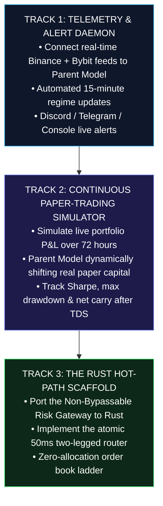

# AERIS NEXT STEPS: THE 3-TRACK EXECUTION PLAN

**Entity:** PKBoost AI Labs &times; AEGIS Quant  
**State:** Alpha Verified &bull; Chaos Tests Passed &bull; Parent Meta-Model Active  
**Goal:** Transition from research sandbox to an automated paper-trading system  

---

## 1. THE 3 CONCRETE TRACKS TO HIT NEXT

---

## 2. DETAIL ON EACH TRACK

### Track 1: Live Telemetry Daemon (`telemetry_daemon.py`)
- **What it does:** Runs continuously in the background. Every 5 minutes, it pulls:
  - Realized 1h volatility on BTC & ETH.
  - Bid-ask spread widths across venues.
  - Live 8-hour funding rates for top 15 assets.
- **The Parent Model Output:** Evaluates current market state (`QUIET_CARRY`, `NORMAL_VOLATILITY`, `LIQUIDATION_CRASH`) and prints the optimal capital weights $\vec{w}$ with the current top 3 carry trades.

### Track 2: The 72-Hour Paper Portfolio Simulator (`paper_runner.py`)
- **The True Reality Check:** Let the entire multi-strategy system run live on real market data for 3 to 7 days in "paper" mode:
  - Starts with simulated $\$100,000$ virtual balance.
  - Parent Model dynamically shifts capital into the top carry assets (e.g. ADA Bybit vs. Binance).
  - Automatically simulates 8-hour funding payouts and rebalancing transactions.
  - Deducts exchange fees and 1% TDS on every simulated transfer.
  - Proves whether our net Sharpe ratio stays $> 2.0$ over multiple market days.

### Track 3: The Rust Hot-Path Core (`aeris-risk` & `aeris-execution`)
- While the paper portfolio runs in Python, we begin scaffolding the production Rust engine in `crates/aeris-risk`:
  - Enforce the **$\le 2.5\text{x}$ leverage limit** we derived from the August 5 crash test.
  - Implement the **50ms emergency IOC cancel timer** for orphan legs.
  - Build the multi-threaded WebSocket order router.

---

## 3. MY RECOMMENDATION: WHAT WE SHOULD DO TONIGHT

I recommend we build **Track 1 & Track 2 right now in `playground/`**:
1. Wire up `playground/strategies/telemetry_daemon.py` to stream live market stats into our `MetaAllocator`.
2. Spin up a live **Paper Portfolio Tracker** so we can watch our virtual \$100k balance collect real 8-hour funding yields starting tonight.
