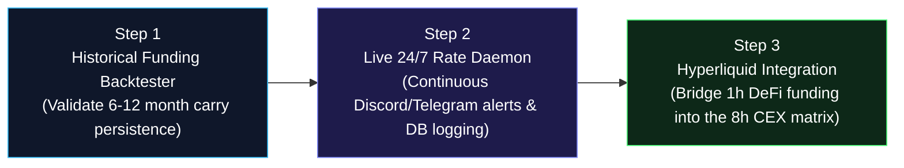
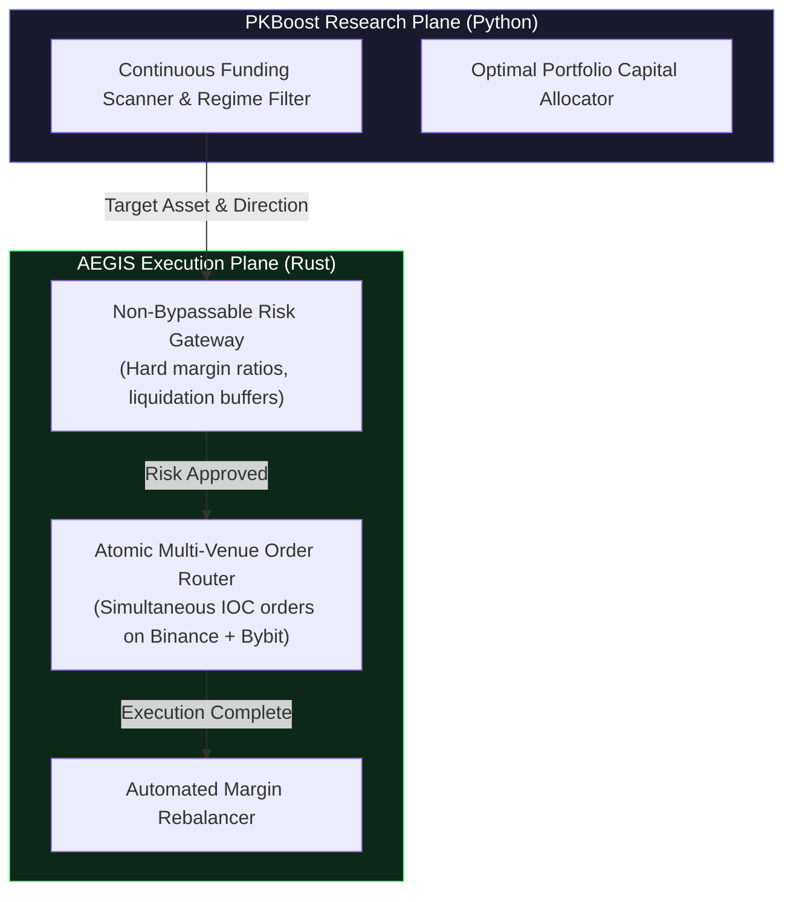

# AERIS STRATEGIC ROADMAP: NEXT STEPS (FROM PLAYGROUND TO PRODUCTION)

**Entity:** PKBoost AI Labs &times; AEGIS Quant  
**Current Milestone:** Track 2 Alpha Verified (20–26% Delta-Neutral Carry on live crypto markets)  
**Objective:** Turn empirical alpha into an automated, risk-managed production engine  

---

## 1. THE THREE IMMEDIATE PLAYGROUND STEPS (NEXT 48 HOURS)

### Step 1: Historical Funding Persistence Backtester
- **The Question to Answer:** When an asset's funding rate diverges (e.g. ADA Bybit vs. Binance at $26\%$ annualized spread), **how long does that mispricing persist before it compresses?**
- **Action:** Pull 6–12 months of historical 8-hour funding rates from the Binance and Bybit public REST archives.
- **Metric:** Calculate the median duration of spread persistence ($T_{1/2}$) and maximum adverse flip rate (how often positive spreads violently reverse).

### Step 2: Live 24/7 Cross-Venue Opportunity Daemon
- **The Goal:** A lightweight background process running in `playground/` that polls Binance, Bybit, and OKX every 15 minutes.
- **Action:**
  - Automatically logs top 5 executable spreads to SQLite / Parquet.
  - Sends immediate alerts (console or webhook) when an asset crosses our **15% Net APY hurdle**.
  - Tracks the exact countdown timer to the next funding settlement block (`00:00`, `08:00`, `16:00 UTC`).

### Step 3: Add Hyperliquid L1 into the Ingestion Matrix
- **Why It Matters:** Hyperliquid frequently has the most extreme funding anomalies because retail crypto traders heavily speculate on decentralized perpetuals.
- **Action:** Build a clean adapter converting Hyperliquid's 1-hour rate into the common 8-hour/annualized format so it dynamically competes against Binance and Bybit in our ranking table.

---

## 2. THE ENGINEERING BRIDGE TO RUST (PHASE 2)

Once the 24/7 daemon and historical persistence are verified in Python, we do **not** write execution logic in slow Python. We transition the proven math into **AEGIS Quant's Rust Engine**:

### Why Rust is Mandatory for the Execution Phase:
1. **Atomic Two-Legged Fill Guarantee:**
   - In funding arb, you must enter both legs (Long Bybit + Short Binance) within **50 milliseconds** of each other. If one leg fills and the other hangs due to a Python garbage collection pause, you have an unhedged naked position during market volatility.
2. **Margin Health & Liquidation Monitor:**
   - A multi-threaded Rust daemon listening to WebSocket private account feeds with sub-millisecond alerting to prevent liquidation on either side.

---

## 3. SUMMARY: RECOMMENDED IMMEDIATE ACTION

1. **Build Step 1 & 2 right now in `playground/`:**
   - Implement a standalone script `playground/strategies/funding_monitor.py` that continuously monitors and ranks the top perpetual spreads 24/7.
   - Run a historical persistence check to measure how many days the ADA and LINK spreads typically stay open.
