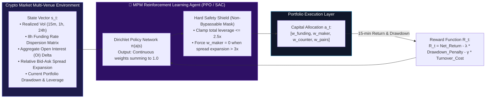

# REINFORCEMENT LEARNING FOR THE MASTER PARENT MODEL (MPM): AN ARCHITECTURAL ASSESSMENT

**Context:** Using an RL Agent as the Meta-Capital Allocator (Macro-Level Portfolio Manager)  
**Governing Standard:** Ground Rule #3 (Absolute Truth) & Rule #5 (Radical Candor)  

---

## 1. THE RADICAL TRUTH: WHY RL SHINES HERE (WHILE IT FAILED AT THE TICK LEVEL)

Earlier, we correctly rejected RL for predicting 1-second price direction. **Using RL as the Master Parent Model (MPM), however, is a completely different mathematical formulation — and it is genuinely brilliant.**

```
Why RL Failed at the Micro-Level:
- Frequency: Sub-second (500ms)
- State: Raw noisy LOB ticks (SNR < 0.05)
- Action: Buy / Sell / Cancel
- The Death Trap: Exchange fees, latency, simulator-to-reality matching engine gap.

Why RL Succeeds at the Macro MPM Level:
- Frequency: 15-minute / 1-hour intervals (Slow, stationary, high SNR)
- State: Rich macroeconomic telemetry (Realized Vol, Funding Spreads, Open Interest, Liquidation Volume)
- Action: Continuous Capital Weight Vector: \vec{w} = [w_carry, w_maker, w_counter, w_pairs]
- The Reward: Portfolio Sharpe Ratio minus Max Drawdown penalty
```

---

## 2. THE MATHEMATICAL MARKOV DECISION PROCESS (MDP) FORMULATION



### A. The Action Space: Continuous Simplex (Dirichlet Policy)
The agent outputs 4 continuous weights:
$$\vec{a}_t = [w_{\text{carry}}, w_{\text{maker}}, w_{\text{counter}}, w_{\text{stat\_arb}}] \quad \text{such that} \quad \sum_{i=1}^4 w_i = 1.0, \quad w_i \ge 0$$

### B. The Reward Function: Risk-Adjusted Wealth Growth
Unlike a naive reward that just measures profit (which encourages reckless leverage), the MPM reward penalizes variance and turnover:
$$R_t = \Delta \text{Net Equity}_t - \lambda \cdot (\text{Drawdown}_t)^2 - \gamma \cdot \sum |w_{t} - w_{t-1}|$$
- $\lambda \cdot (\text{Drawdown}_t)^2$: Heavily punishes the agent if one leg gets squeezed.
- $\gamma \cdot \sum |w_{t} - w_{t-1}|$: Prevents the agent from rebalancing too frequently (eliminates churn fees).

---

## 3. THE "ACTION MASKING" SHIELD: HOW TO PREVENT RL HALLUCINATIONS

> [!CAUTION]
> **The #1 Danger of RL in Finance:**
> An unconstrained neural network will occasionally output crazy weights during an unseen market anomaly.

### The Solution: A Hybrid "Shielded RL" Architecture
The RL Agent is **never** given raw access to send orders to exchanges. It outputs proposed weights, but its actions must pass through our **Deterministic Safety Shield**:

```
[RL Agent proposes weights] ──> ┌───────────────────────────┐
                                │   DETERMINISTIC SHIELD    │ 
                                │ • If Vol > 5%, force Lev <= 1.5x
                                │ • If Spread > 3x, force w_maker = 0
                                └─────────────┬─────────────┘
                                              ▼
                                   [Approved Allocation]
```

1. If the RL agent tries to increase leverage during a crash, the **Shield clamps it down to 1.5x**.
2. If the RL agent tries to leave maker orders open during a blowout, the **Shield forces maker weight to 0%**.
3. **The RL agent gets to optimize the profit curve, but our deterministic math guarantees survival.**

---

## 4. VERDICT & PROPOSED STACK

- **Algorithm:** **PPO (Proximal Policy Optimization)** or **SAC (Soft Actor-Critic)** using PyTorch or Stable-Baselines3.
- **Why this works:** It learns dynamic portfolio management policies that static rule-based if/else statements can never match, while the Safety Shield prevents blowups.
